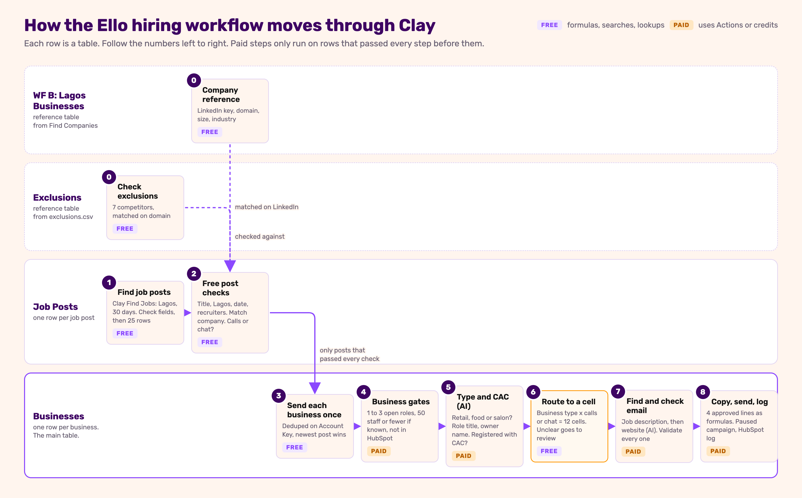

# Clay Build Guide: Lagos businesses hiring a customer service rep (Ello)

A step-by-step guide to building `output/campaigns/hiring-customer-service-rep/workflow-spec.md` in Clay. Written for someone who has never built anything in Clay. Follow the parts in order. Each step tells you **why** it exists, **what to click**, **what to type**, **how to check it worked** and **what it costs**.

> **Updated 2026-11-25** to match the spec: job posts come from Clay Find Jobs, matched to `WF B: Lagos Businesses` on company LinkedIn URL. The Stage 1 CSV, Maps and Instagram fields are gone. Older changes are listed at the end.

> **Don't skip the checks.** The most common Clay mistake is running a column on every row before checking it worked on 1. Every step below ends with a check. If the check fails, fix it before moving on.

---

## Contents

- [What you are building](#what-you-are-building)
- [Clay words you need](#clay-words-you-need)
- [Before you start](#before-you-start)
- [Part 0. Set up the workbook](#part-0-set-up-the-workbook)
- [Part 1. Get the job posts](#part-1-get-the-job-posts)
- [Part 2. Free checks on each post](#part-2-free-checks-on-each-post)
- [Part 3. Businesses table (each business once)](#part-3-businesses-table)
- [Part 4. Business gates](#part-4-business-gates)
- [Part 5. Business type, role title and CAC (AI)](#part-5-business-type-role-title-and-cac)
- [Part 6. Route each business to a cell](#part-6-route-each-business-to-a-cell)
- [Part 7. Find and check the email](#part-7-find-and-check-the-email)
- [Part 8. Write the email lines](#part-8-write-the-email-lines)
- [Part 9. Views for the operator](#part-9-views-for-the-operator)
- [Part 10. Connect the sequencer (build it, don't run it)](#part-10-connect-the-sequencer)
- [What it costs](#what-it-costs)
- [Final checklist](#final-checklist)
- [When something goes wrong](#when-something-goes-wrong)
- [Things the spec needs to fix](#things-the-spec-needs-to-fix)

---

## What you are building

The spec says: find **Lagos businesses that posted a job in the last 30 days for someone to answer customers** (customer service, order taking, sales rep, receptionist, front desk). Keep only small retail, food and salon businesses that aren't recruiters, competitors or already in HubSpot. Sort each one into one of **12 cells** (business type x whether the job is about calls, chat, both or not stated). Find the owner's email, and write the approved 3-email sequence (days 0, 3 and 8) to them.

The job posts come from **Clay's Find Jobs search**. Everything is built inside Clay (spec Section 3a).

You will build **2 tables** (`Job Posts` and `Businesses`) in the workbook you already have, using **2 reference tables**: `WF B: Lagos Businesses` (company facts) and `Exclusions` (competitors to block):



Each row of the picture is a table. The numbers are the order you build in. Step 0 is the two reference tables.

Why this shape:
- **Signal first**, because the trigger is a dated event: a job post. One row per post comes in, and the cheap checks (title, Lagos, date) run there.
- **Business checks happen once per business.** If one salon posted two jobs, you pay once to classify and check it, and it gets one email sequence, not two (spec Section 7: one sequence per business per 90 days).
- **Everything paid runs last**, and only on rows that passed every free check before it.
- **Matching uses LinkedIn, then `Account Key`.** Clay normally matches on domain, but many of these businesses have none (383 of the 1,307 reference rows, read 2026-11-25). Posts match the reference table on the LinkedIn company slug. `Account Key` (spec Section 6) is `li|` plus that slug, or the cleaned name plus `|lagos` when there's no slug.
- **No match is fine.** A post whose employer isn't in the reference table continues with `Size Unknown?` = true.

What a finished row in **Businesses** looks like, reading left to right (made-up example):

| Business | Account Key | Job title | Role title | Type | Channel | Cell | CAC | Ready? | Email | E1 L1 |
|---|---|---|---|---|---|---|---|---|---|---|
| Acme Kitchen | li\|acme-kitchen | Order Taker (Female) | order taker | s2_food | calls | S2 x calls | found | true | orders@… (from the job description) | You're looking for a new order taker, so I'd guess orders are picking up. |

---

## Clay words you need

| Word | What it means |
|---|---|
| **Workbook** | A folder of tables for one campaign. |
| **Table** | A spreadsheet. One row per job post, or one row per business. |
| **Source** | Where a table's rows come from (a search, a CSV, another table). |
| **Column** | One piece of information per row. Three kinds matter: **plain** (you type or import it), **formula** (Clay calculates it, free), **enrichment / action** (Clay calls a provider or AI, usually costs). |
| **Formula** | A small calculation, like a spreadsheet formula. Free. Clay has an AI helper: describe what you want in plain English and it writes the formula. |
| **Use AI** | An AI column that reads the row's data and answers a question. Costs Actions plus a small AI cost. |
| **Claygent** | An AI column that also **browses websites**. Costs more than Use AI. Used here for the CAC check and for finding an email on a business website. |
| **Lookup** | A column that reads matching rows from another table in your workbook. Free. |
| **Send table data** | A column that copies rows from this table into another table. Free. |
| **Run condition** ("Only run if") | A rule on a paid column: it only runs on rows where the rule is true. This is how you avoid paying for rows you'll throw away. |
| **Auto-run** | When on, new columns run on every row by themselves. **Keep it off** while building. |
| **Actions** | Clay's main usage meter. About 1 Action per enrichment or AI column per row. Unused Actions expire monthly. |
| **Data Credits** | A second meter, used when Clay pays a data provider for you. |
| **View** | A saved filter on a table, like "only rows ready to send". |
| **Checkbox column** | A plain column you tick by hand. Used here so a person can approve a row the AI couldn't decide. |
| **Account Key** | This build's ID for a business (`li\|` + LinkedIn slug, or `name\|lagos`). Not a Clay word: the spec's. |

---

## Before you start

Tick these off **before** the session. None of them should be done live.

- [ ] **Clay account** with access to the workspace you'll build in. Note which plan it's on (Settings → Plans & billing) and how many Actions are left. See [What it costs](#what-it-costs).
- [ ] **HubSpot connected to Clay** (Settings → Connections → HubSpot). In HubSpot, create these company properties. Part 4 checks against them. `ello_last_outreach_date` and HubSpot's built-in `domain` are shared with Workflow C (Instagram order posts), so a business with a known domain contacted by either campaign is skipped by the other for 90 days. If Workflow C's build created any already, don't create them twice.
  - `account_key`, `linkedin_company_url` (single-line text). `domain` is built in: don't create it.
  - `ello_last_outreach_date` (**date picker**). Both workflows write it on every contact. It drives the 90-day rule, because a logged HubSpot note doesn't update "last contacted".
  - Also confirm the internal names of two built-in properties: lifecycle stage (expected `lifecyclestage`) and number of open deals (expected `hs_num_open_deals`). HubSpot → Settings → Properties → Company → click the property → the internal name is under its label. If either differs, use the real name in Part 4.2 and tell the spec owner.
- [ ] **CAC test, before the build test.** Pick 5 Lagos businesses you already know are CAC-registered. You'll run the Part 5.3 Claygent on them first. If it can't read the CAC search results, you'll do the CAC check by hand instead.
- [ ] **The spec is open** next to you: `output/campaigns/hiring-customer-service-rep/workflow-spec.md`. Sections 2 (who's in and out), 3a (build order), 4 (signals), 5 (cells), 6 (variables) and the Copy section are what you're building.
- [ ] **`WF B: Lagos Businesses`** exists in the workbook `Companies Hiring Support Rep` (1,307 rows on 2026-11-25). Use this one, **not** `Revised_WF B: Lagos Businesses`, which has no source attached.
- [ ] **Find Jobs fields.** Clay's public docs don't list them, so Part 1.2 is a real check with stop rules.
- [ ] **`exclusions.csv`** from this folder (`output/campaigns/hiring-customer-service-rep/clay-build/`): 7 competitors with domain, Instagram handle (where known) and source. An `Exclusions` table already exists in the workbook; Part 2.3 checks it. The handle column isn't used on this route. Don't add guessed domains or handles to it.
- [ ] **Test size: 25 job posts.** You can import more later. Note: the spec's email coverage test needs 20 businesses that pass every gate, and 25 posts will give fewer than that. Treat this run as a build test, then import a bigger batch for the coverage test.
- [ ] **Sequencer:** not chosen yet (spec Section 7). You can build everything up to Part 9 without it. Part 10 waits until it's chosen.

---

## Part 0. Set up the workbook

**Why:** one place for everything in this campaign, so anyone can find it and follow it.

1. Open the workbook `Companies Hiring Support Rep`.
2. In its description, paste: *"Signal: Lagos retail, food and salon businesses that posted a customer-facing job in the last 30 days. Spec: ello-gtm-os/output/campaigns/hiring-customer-service-rep/workflow-spec.md. Posts come from Clay Find Jobs. Email only, 3 emails, days 0/3/8."*
3. Open `WF B: Lagos Businesses` and turn **Auto-run OFF**. Don't send anything from this table: it is reference only.
4. Add a free formula column `LinkedIn Key`. Plain English: *"The part after /company/ in LinkedIn URL, in lowercase, without anything after it. Blank if there isn't one or it is only numbers."*
```javascript
((({{LinkedIn URL}} || "").toLowerCase().match(/linkedin\.com\/company\/([^\/?#]+)/) || [])[1] || "").replace(/^\d+$/, "")
```

**Check:** `https://www.linkedin.com/company/dscentsation` gives `dscentsation`. Its old `Account Key` column (`name|lagos`) isn't used in this build.
**Cost:** free.

---

## Part 1. Get the job posts

**Why:** this is the trigger (spec Section 1). Each row is one job post.

### 1.1 Search

1. Inside the workbook, click **+ Add table** → **Find Jobs** (may be listed under "Find" or "Sources", or as "Jobs").
2. Location: **Lagos, Nigeria**. Posted: **last 30 days**.
3. Job titles, one entry each: `customer service`, `customer care`, `customer support`, `client service`, `order taker`, `order taking`, `order processing`, `order officer`, `order handler`, `online sales`, `inside sales`, `telesales`, `sales rep`, `sales representative`, `receptionist`, `front desk`.
4. **Write down the result count.** Note both credit counters, then import **5 rows** first. Name the table `Job Posts`. Turn **Auto-run OFF**.

### 1.2 Check the fields before importing more

Open the source cell of 3 rows, then add each field as a column with these names (Clay's own names may differ):

| Field from Find Jobs | Column name | Data type | If it's missing |
|---|---|---|---|
| Company name | `Employer Name` | Text | Stop |
| Job title | `Job Title` | Text | Stop |
| Location | `Location` | Text | Stop |
| Posted date | `Posted Date` | Date (or Text) | **Stop.** The 30-day check can't run |
| Job URL | `Job URL` | URL | Stop |
| Company LinkedIn URL | `Company LinkedIn URL` | URL | **Stop.** Nothing can match |
| Full description | `Description` | Text | **Stop and decide.** Every row would be `not_stated` (3 of 12 cells) |
| Company domain | `Job Company Domain` | URL | Continue: add an empty text column with this name so the formulas work |

`Posted Date` must read as a real date. If it says "3 days ago", stop: that text can't be recalculated later.

### 1.3 Import the test and remove duplicates

1. When the fields are right, raise the import to **25 rows** (or create the search again with a limit of 25).
2. Table settings → **Deduplicate** → `Job URL`.

**Check:** 25 rows or fewer. Open 3 `Job URL`s and confirm each is a real Lagos post with the title and date shown.
**Cost:** the search is free (per Fredrick, 2026-11-25). Compare both credit counters before and after the first 5 rows.

---

## Part 2. Free checks on each post

**Why:** drop the posts we know are wrong **before** spending anything (spec Sections 2 and 4, signals 1 and 3). Everything here is a formula or a lookup inside Clay, so it should be free; check the counters on the lookups.

**How to add a formula column:** click **+ Add column** (right end of the table) → **Formula**. You can type the formula, or click **Use AI** inside the formula box and describe it in plain English. When the formula refers to another column, type `/` and pick the column from the list. Below, columns are written as `{{Column Name}}`. Paste the plain English into the column's description too, so anyone reading the table knows what it does.

### 2.1 Clean the name and build the key

| Column | Plain English for the AI helper | Formula |
|---|---|---|
| `Business Name` | Employer Name without a location at the end and without company words at the end (spec Section 6). The location is removed only when it comes after a spaced dash (" - " or " – "), a comma, or inside brackets, and only when it is Lagos or a Lagos area (Workflow C's list), or several of them separated by commas. Then "Ltd", "Limited", "Nig", "Nigeria Limited" (and combinations like "Nig Ltd") are removed, only as whole words at the very end | See the formula below the table |
| `LinkedIn Key` | The part after /company/ in Company LinkedIn URL, lowercase; blank if there isn't one or it is only numbers | Same formula as Part 0, reading `{{Company LinkedIn URL}}` |
| `LinkedIn URL Clean` | "linkedin.com/company/" plus LinkedIn Key; blank if no key | `{{LinkedIn Key}} ? "linkedin.com/company/" + {{LinkedIn Key}} : ""` |
| `Account Key` | "li\|" plus LinkedIn Key; if blank, Business Name in lowercase with single spaces, followed by "\|lagos" | `{{LinkedIn Key}} ? "li\|" + {{LinkedIn Key}} : (({{Business Name}} \|\| "").toLowerCase().replace(/\s+/g, " ").trim() + "\|lagos")` |

`Business Name` formula:
```javascript
(({{Employer Name}} || "").trim()
  .replace(/(\s+[-–]\s+|\s*,\s*|\s*\(\s*)((lagos|lekki|ikeja|yaba|surulere|ajah|ikoyi|victoria island|festac|gbagada|ikorodu|magodo|ogba|oshodi|egbeda|ojodu|ilupeju|isolo|apapa|sangotedo|chevron)(\s*,\s*(lagos|lekki|ikeja|yaba|surulere|ajah|ikoyi|victoria island|festac|gbagada|ikorodu|magodo|ogba|oshodi|egbeda|ojodu|ilupeju|isolo|apapa|sangotedo|chevron))*)\s*\)?\s*$/i, "")
  .replace(/\s+(nig(eria)?\.?\s+)?(ltd|limited)\.?$/i, "")
  .replace(/\s+nig(eria)?\.?$/i, "")
  .trim())
```

**Check:** each of these must come out as shown:
- "Glow Studio Ltd - Lagos" → `Glow Studio` (with no LinkedIn key, its key is `glow studio|lagos`)
- "Glow Studio (Lagos)" → `Glow Studio`
- "Glow Studio, Ikeja" → `Glow Studio`
- "Glow Studio - Lekki, Lagos" → `Glow Studio`
- "Acme Foods Nigeria Limited" → `Acme Foods`; "Acme Foods Nig" → `Acme Foods`
- "Nigella's Kitchen" → `Nigella's Kitchen` (unchanged)
- "Jay-Jay Foods" → `Jay-Jay Foods` (a dash without spaces is kept)

### 2.2 The trigger checks (signal 1)

| Column | Plain English | Formula |
|---|---|---|
| `Title Match?` | True if the job title is a customer-facing role from the spec's list, matched as whole words | `/customer (service\|care\|support)\|client service\|\border (taker\|taking\|processing\|officer\|handler)s?\b\|\b(online\|inside\|tele) ?sales\b\|\bsales rep(resentative)?s?\b\|receptionist\|front desk/i.test({{Job Title}} \|\| "")` |
| `In Lagos?` | True if Location contains Lagos | `/lagos/i.test({{Location}} \|\| "")` |
| `Days Since Posted` | Whole days between Posted Date and today; blank if there's no date | `{{Posted Date}} ? Math.floor((Date.now() - new Date({{Posted Date}}).getTime()) / 86400000) : null` |
| `Trigger?` | True if Title Match and In Lagos are true and Days Since Posted is from 0 to 30 | `{{Title Match?}} === true && {{In Lagos?}} === true && {{Days Since Posted}} !== null && {{Days Since Posted}} >= 0 && {{Days Since Posted}} <= 30` |

**Check:** "Customer Service Representative" → true. "Border Security Officer" → false (the old pattern matched it). "Warehouse Order Picker" → false. A post dated 10 days ago shows 10.

### 2.3 The exclusion checks (spec Section 2, Exclude)

**First, match the post to the reference table.** **+ Add column** → **Lookup single row in other table** → table `WF B: Lagos Businesses`, match `LinkedIn Key` = `{{LinkedIn Key}}`. Name it `Reference Match`. Run condition: `{{Trigger?}} === true && !!{{LinkedIn Key}}`. Run on **1 row** and check the counters. Never match on name.

Then add these free formulas. Let the AI helper set the paths from a real matched cell:

| Column | Plain English | Formula |
|---|---|---|
| `Size Unknown?` | True if Reference Match found nothing | `!{{Reference Match}}?.["LinkedIn Key"]` |
| `Reference Size` | Size from Reference Match, or blank | `{{Reference Match}}?.["Size"] \|\| ""` |
| `Reference Industry` | Primary Industry from Reference Match, or blank | `{{Reference Match}}?.["Primary Industry"] \|\| ""` |
| `Reference Description` | Description from Reference Match, or blank | `{{Reference Match}}?.["Description"] \|\| ""` |
| `Company Domain` | Job Company Domain, else the matched Website Domain; lowercase, no https, www or path | `({{Job Company Domain}} \|\| {{Reference Match}}?.["Website Domain"] \|\| "").trim().toLowerCase().replace(/^https?:\/\//, "").replace(/^www\./, "").split(/[\/?#]/)[0]` |

**Next, check `Exclusions`.** It should have 7 rows, 6 with a domain. If it's missing, **+ Add table** → **Import CSV** → `exclusions.csv`. Auto-run **off**.

> **Fresha has no domain on purpose:** salons use `fresha.com` booking links as their website, so a domain match would block real prospects. Fresha is caught by name only. Don't add `fresha.com` back.

**+ Add column** → **Lookup single row in other table** → `Exclusions`, match `Domain` = `{{Company Domain}}`. Name it `Excluded by Domain`. Run condition: `!!{{Company Domain}}`. A lookup on a blank value could match Fresha's blank domain.

Now the exclusion formulas:

| Column | Plain English | Formula |
|---|---|---|
| `Recruiter Name?` | True if Employer Name looks like a recruiter, staffing or outsourcing firm | `/recruit\|staffing\|outsourc\|bpo\|human resource\|manpower\|consult/i.test({{Employer Name}} \|\| "")` |
| `No Employer?` | True if Employer Name is empty or says confidential | `!{{Employer Name}} \|\| /confidential/i.test({{Employer Name}})` |
| `Competitor?` | True if Business Name is one of the spec's competitors (Viqe, Zana, CherryBrooks, CallAI, Obeks, NativeTalk, PressOne, Salescabal, Bumpa, Fresha), OR the Exclusions lookup found a row | `/\b(viqe\|zana\|cherrybrooks\|callai\|obeks\|nativetalk\|pressone\|salescabal\|bumpa\|fresha)\b/i.test({{Business Name}} \|\| "") \|\| !!{{Excluded by Domain}}` |

The name check stays because some posts have no domain. The lookup catches a competitor posting under a name the pattern misses.

**Check:** add a test row with Job Company Domain `https://www.getbumpa.com/pricing`: `Company Domain` is `getbumpa.com` and `Competitor?` is true. Add `Test Salon` with `https://www.fresha.com/a/test-salon`: `Competitor?` is false. With no domain, the lookup doesn't run. Delete the test rows.

> The spec also excludes **existing Ello users**. That check is **not active in v1**: it turns on when the Ello team sends a list of sign-up handles (spec Section 2). When it arrives, add those businesses to the `Exclusions` table with `Type` = `ello_user` (with their domain where known), and the lookup blocks them too. If the list only gives business names, add an `Account Key` column to `Exclusions` and a second lookup on it.

### 2.4 Which channels the job covers (signal 3, a router)

**Why:** this decides Email 1 line 2 and Email 3 line 1. The spec tightened these patterns so phrases like "send your CV to this phone number" or "chatty personality" don't count.

| Column | Plain English | Formula |
|---|---|---|
| `Chat Words?` | True if the description talks about answering messages: WhatsApp or Instagram orders, messages, enquiries or DMs; DMs; direct messages; live chat; online orders or enquiries; social media enquiries, messages or pages; responding to messages or chats | `/\b(whatsapp\|instagram) (orders?\|messages\|enquiries\|dms?\|chats?)\b\|\bdms?\b\|direct messages\|live chat\|online (orders\|enquiries)\|social media (enquiries\|messages\|pages)\|respond(ing)? to (messages\|chats)/i.test({{Description}} \|\| "")` |
| `Call Words?` | True if the description talks about answering calls: answering calls or the phone; phone orders, calls or enquiries; inbound, incoming or outbound calls; telephone orders or enquiries; calling customers or clients | `/answer(ing)? (calls\|the phone\|phone calls)\|phone (orders\|calls\|enquiries)\|(inbound\|incoming\|outbound) calls\|telephone (orders\|enquiries)\|call (customers\|clients)/i.test({{Description}} \|\| "")` |
| `Role Channel` | "both" if both are true, "chat" if only Chat Words, "calls" if only Call Words, otherwise "not_stated" | `{{Chat Words?}} && {{Call Words?}} ? "both" : {{Chat Words?}} ? "chat" : {{Call Words?}} ? "calls" : "not_stated"` |
| `Instagram DMs?` | True if Description names Instagram orders, messages, enquiries, DMs or chats, or mentions Instagram and also DMs or direct messages. Only used to pick the Email 3 line | `/\binstagram (orders?\|messages\|enquiries\|dms?\|chats?)\b/i.test(({{Description}} \|\| "")) \|\| (/\binstagram\b/i.test(({{Description}} \|\| "")) && /\bdms?\b\|direct messages/i.test(({{Description}} \|\| "")))` |

**Check `Instagram DMs?`:** "reply to Instagram DMs" → true. "handle WhatsApp orders" → false. "post on Instagram" → false.

**Check:** the spec asks for these patterns to be tested on **50 real descriptions** before the full run. With 25, read every one: does `Role Channel` match what a person would say the job is about? Write down any miss and the phrase that caused it. Fix the pattern in the spec first, then here.

### 2.5 `Post Pass?`

- Plain English: *"True if Trigger is true, and Recruiter Name, No Employer and Competitor are all false."*
- Formula:
```javascript
{{Trigger?}} === true && !{{Recruiter Name?}} && !{{No Employer?}} && !{{Competitor?}}
```

**Check:** sort by `Post Pass?`. Open every "false" row and make sure each one deserves to be out. If a good post is false, fix the formula, not the row.
**Cost:** free.

---

## Part 3. Businesses table

**Why:** everything from here is checked and sent **once per business** (spec Section 7: one sequence per business).

### 3.1 Create the empty table

1. **+ Add table** → **Blank table**. Name it `Businesses`.
2. Add these text columns: `Account Key`, `Business Name`, `Job Title`, `Description`, `Role Channel`, `LinkedIn URL Clean`, `Company Domain`, `Reference Size`, `Reference Industry`, `Reference Description`, `Job URL` (URL), `Posted Date`, `Size Unknown?` (Checkbox) and `Instagram DMs?` (Checkbox).
3. Table settings → **Deduplicate** → choose `Account Key`.
4. Turn **Auto-run off** here too.

### 3.2 Send businesses over from Job Posts

Back in `Job Posts`:

1. **Sort** the table by `Posted Date`, newest first. When a business has more than one post, Clay keeps the first one it receives, so this makes the **newest post** the one whose title and description are used for routing.
2. **+ Add column** → **Send table data** (sometimes listed as "Write to table").
3. Destination table: `Businesses`. Map each column in 3.1 to the column of the same name in `Job Posts`.
4. **Run condition:** `{{Post Pass?}} === true`. Posts that failed Part 2 never reach Businesses.
5. Run on **1 row** first. Open `Businesses` and check it arrived with every field filled the same as in `Job Posts`.
6. Then run on the rest.

**Check:** `Businesses` has no duplicate `Account Key`s and no more rows than the `Post Pass?` = true count. If a business posted twice, its row shows the newer post's title.
**Cost:** free.

---

## Part 4. Business gates

**Why:** spec Section 2 keeps only small businesses (1 to 3 open roles, 50 employees or fewer when matched to the reference table) that aren't already in HubSpot. These run before any AI, so you never pay to classify a business you can't email.

### 4.1 `Open Roles` (lookup + formula, free)

1. In `Businesses`: **+ Add column** → **Lookup multiple rows in other table** → table `Job Posts`, match `Account Key` = `{{Account Key}}`. Name it `Matching Posts`.
2. Formula `Open Roles`. Plain English: *"How many different Job URLs the Matching Posts with Trigger true have."* Let the AI helper write it from a real cell, because the field names depend on what the lookup returns. It will look roughly like:
```javascript
new Set(({{Matching Posts}} || []).filter(p => p["Trigger?"] === true).map(p => p["Job URL"])).size
```

**Check:** pick a business you know posted twice in `Job Posts`. `Open Roles` shows 2.

> This only counts posts imported from Find Jobs (with 25 rows, a small slice), so it undercounts businesses that also post elsewhere (spec Section 2).

### 4.2 `HubSpot Match` (lookups in HubSpot)

**Why three lookups:** the spec (Sections 2 and 6) checks LinkedIn URL, then domain, then account key. `domain` is the only key shared with Workflow C.

First add the free formula `Size OK?`. Plain English: *"True if Size Unknown is true, or Reference Size is Self-employed, 2-10 employees or 11-50 employees."*
```javascript
{{Size Unknown?}} === true || ["Self-employed", "2-10 employees", "11-50 employees"].includes({{Reference Size}})
```
**Check:** an unmatched business is true; a matched "51-200 employees" is false.

Add up to three HubSpot lookups, in this order. Each one only runs if the ones before found nothing:

| Column | HubSpot property to match | Value | Run condition |
|---|---|---|---|
| `HubSpot by LinkedIn` | `linkedin_company_url` | `{{LinkedIn URL Clean}}` | `{{Size OK?}} === true && {{Open Roles}} >= 1 && {{Open Roles}} <= 3 && !!{{LinkedIn URL Clean}}` |
| `HubSpot by Domain` | `domain` | `{{Company Domain}}` | `{{Size OK?}} === true && {{Open Roles}} >= 1 && {{Open Roles}} <= 3 && !!{{Company Domain}} && !{{HubSpot by LinkedIn}}` |
| `HubSpot by Key` | `account_key` | `{{Account Key}}` | `{{Size OK?}} === true && {{Open Roles}} >= 1 && {{Open Roles}} <= 3 && !{{HubSpot by LinkedIn}} && !{{HubSpot by Domain}}` |

For each: **+ Add column** → search for **HubSpot** → **Lookup company** (may be called "Find object" or "Lookup object"; choose the Company object) → set the property and value from the table → add the run condition.

In each lookup, ask for these properties back: `lifecyclestage`, `hs_num_open_deals`, `ello_last_outreach_date` (or the real internal names you confirmed in Before you start).

1. Run each on **1 row** first. Read the cell: it's empty if HubSpot has no such company, which is expected for most rows.
2. Formula `In HubSpot?`. Plain English: *"True if any of the three HubSpot lookups found a company whose lifecycle stage is customer, OR whose number of open deals is above 0, OR whose ello_last_outreach_date is within the last 90 days."* This is the spec's suppression rule (Section 2). A starting formula:
```javascript
[{{HubSpot by LinkedIn}}, {{HubSpot by Domain}}, {{HubSpot by Key}}].some(c => !!c && (
  c.lifecyclestage === "customer" ||
  Number(c.hs_num_open_deals || 0) > 0 ||
  (!!c.ello_last_outreach_date && (Date.now() - new Date(c.ello_last_outreach_date).getTime()) / 86400000 <= 90)
))
```
   Clay may nest the properties differently (for example under `properties`). Open a cell that has a match and adjust the paths, or let the AI helper rewrite it from the plain English. To get a match, add a test company in HubSpot with a known `linkedin_company_url` and test it three times: as a customer, with an open deal, and with `ello_last_outreach_date` set to last week. Each time `In HubSpot?` must be true. Set the date to 100 days ago with no deal and a non-customer stage: it must be false. Delete the test company afterwards.

**Cost:** check the Actions counter before and after the 1-row run. Some plans charge an Action per CRM lookup, others don't. Write down what you see.

### 4.3 `Pass Business Gates?`

| Column | Plain English | Formula |
|---|---|---|
| `Pass Business Gates?` | True if Open Roles is 1 to 3, Size OK is true and In HubSpot is not true | `{{Open Roles}} >= 1 && {{Open Roles}} <= 3 && {{Size OK?}} === true && {{In HubSpot?}} !== true` |

**Check:** filter `Pass Business Gates?` = false and read why each is out.
**Cost:** free (except the HubSpot lookup, see 4.2).

---

## Part 5. Business type, role title and CAC

### 5.1 `Business Type (AI)`: Use AI (signals 2 and 4, and the owner's name)

**Why AI and not a formula:** the business type routes the copy (spec Section 5), and you can't reliably tell a salon from a boutique from a restaurant by keywords in an employer name. The same column also cleans the job title into the short role the emails use and reads the owner's first name, so you pay for one AI call, not three.

1. **+ Add column** → **Use AI**.
2. Prompt:
   > *You are sorting Lagos small businesses that are hiring someone to answer their customers.*
   >
   > *Employer: {{Business Name}}. Job title as posted: {{Job Title}}. LinkedIn industry (may be empty): {{Reference Industry}}. Company description (may be empty): {{Reference Description}}. Job description: {{Description}}*
   >
   > *1. segment: what the business does. One of:*
   > *"s1_retail": sells products to the public, in a shop or online or on social media (for example clothes, shoes, cosmetics, phones, gadgets, home goods).*
   > *"s2_food": restaurant, takeout, bakery, catering, food or drinks delivery.*
   > *"s3_salon": hair, nails, barbing, make-up, spa or other beauty services.*
   > *"recruiter": a recruitment, staffing, HR or outsourcing firm hiring for someone else.*
   > *"clinic": a hospital, clinic, dental, lab or other healthcare service.*
   > *"other": anything else, such as banks, telecoms, fintech, logistics, real estate, schools, or companies that sell to other businesses.*
   > *"unclear": the information above isn't enough to tell. Don't guess from the business name alone.*
   >
   > *2. role_title: the job as a short lowercase role a business owner would say, such as "order taker", "customer service rep", "receptionist" or "sales rep". No gender, salary, location, company name or seniority words. If you can't tell, write "customer service rep".*
   >
   > *3. owner_first_name: the first name of the business's owner, only if the company description or the job description calls that person the owner, founder, CEO or MD (for example "Founder: Ada Okafor" or "CEO, Chioma"). First name only, no title such as Mr, Mrs or Chef. Never use the name of the person who collects applications ("send your CV to Mrs Bisi"), an HR person or a recruiter. Empty if no owner is named. Never guess.*
   >
   > *4. evidence: a short quote from the job description, company description or industry that supports the segment. Empty if unclear.*
3. Output format: **JSON**, with exactly these fields:
   - `segment`: text, must be one of `s1_retail`, `s2_food`, `s3_salon`, `recruiter`, `clinic`, `other`, `unclear`
   - `role_title`: text
   - `owner_first_name`: text
   - `evidence`: text
4. **Run condition:** `{{Pass Business Gates?}} === true`
5. Run on **3 rows you can judge yourself**: one obvious shop, one obvious food business, one salon (or a recruiter, if one slipped through). Read each answer and its evidence. If one is wrong, fix the prompt and re-run the same 3. Include at least one post that names an application contact ("send your CV to…"): its `owner_first_name` must be empty.
6. Then run on the rest.

**Cost:** about **1 Action plus a small AI cost per business**.

### 5.2 Helper columns (free)

Two plain columns first, for a person to fill in during review:
- `Segment Override` (Text): left empty, unless a reviewer decides an `unclear` business. Only `s1_retail`, `s2_food` or `s3_salon` are allowed.
- `CAC Override` (Checkbox): left unticked, unless a reviewer confirms the CAC registration by hand (5.3).

| Column | Plain English | Formula |
|---|---|---|
| `Segment` | The Segment Override if filled, otherwise the AI's segment, otherwise "unclear" | `{{Segment Override}} \|\| {{Business Type (AI)}}?.segment \|\| "unclear"` |
| `Role Title` | The AI's role title, otherwise "customer service rep" | `{{Business Type (AI)}}?.role_title \|\| "customer service rep"` |
| `In Segment?` | True if Segment is s1_retail, s2_food or s3_salon | `["s1_retail", "s2_food", "s3_salon"].includes({{Segment}})` |

> **What `unclear` means:** it never gets a cell and never gets an email (spec Section 5). It goes to the `Review: business type` view (Part 9). A reviewer either fills `Segment Override` or leaves it out.

**Check:** filter `In Segment?` = true and read every `evidence`. Would you agree with each one?

### 5.3 `CAC Check`: Claygent (registration review)

**Why:** the spec (Section 2) wants businesses registered with the Corporate Affairs Commission. CAC's public search is a website form with no API, so only a browsing AI (or a person) can check it. In v1 this is a **review step**: anything not clearly found goes to a person.

1. **+ Add column** → **Claygent**.
2. Prompt:
   > *Go to the Corporate Affairs Commission (CAC) public search for Nigeria (search.cac.gov.ng; if that address doesn't work, search the web for "CAC public search"). Search for the business name "{{Business Name}}".*
   >
   > *1. cac_status: "found" if a registered business or company with this name, or a very close match, appears. "not_found" if the search returns nothing close. "unclear" if the site didn't load, asked for a login or a captcha, or several different businesses match.*
   >
   > *2. registered_name: the name exactly as CAC shows it. Empty if not found.*
   >
   > *3. registration_number: the RC or BN number CAC shows. Empty if not found.*
   >
   > *4. evidence: one line on what you saw. Don't guess.*
3. Output format: **JSON**: `cac_status` (one of `found`, `not_found`, `unclear`), `registered_name`, `registration_number`, `evidence`.
4. **Run condition:** `{{Pass Business Gates?}} === true && {{In Segment?}} === true`
5. **First, the CAC test (spec Section 2):** add the 5 known CAC-registered businesses from Before you start as test rows (or temporarily point the prompt at their names) and run on those 5. If Claygent doesn't return `found` for them, it can't read the CAC site: **stop**, delete the column and do the check by hand instead, ticking `CAC Override` for each business you confirm. Delete the test rows afterwards.
6. If the test passes, run on **2 or 3 real businesses** you've checked yourself, then on the rest.

Then add the formula:

| Column | Plain English | Formula |
|---|---|---|
| `CAC OK?` | True if the CAC check says found, or a reviewer ticked CAC Override | `{{CAC Check}}?.cac_status === "found" \|\| {{CAC Override}} === true` |

**Cost:** Claygent costs **more per row than Use AI** because it browses. It only runs on businesses that passed every gate and are in S1 to S3.

---

## Part 6. Route each business to a cell

### 6.1 `Cell`

The spec's 12 cells are business type (3) x role channel (4).

- Plain English: *"If In Segment is false, leave blank. Otherwise S1 for s1_retail, S2 for s2_food, S3 for s3_salon, then ' x ', then the Role Channel. For example 'S2 x calls'."*
```javascript
!{{In Segment?}} ? "" : ({"s1_retail": "S1", "s2_food": "S2", "s3_salon": "S3"})[{{Segment}}] + " x " + {{Role Channel}}
```

### 6.2 `Ready to Contact?`

Every check from the spec in one column. Only rows with **true** get an email search and copy.

- Plain English: *"True if Pass Business Gates is true, Cell is not empty and CAC OK is true."*
```javascript
{{Pass Business Gates?}} === true && {{Cell}} !== "" && {{CAC OK?}} === true
```

**Check:** filter `Ready to Contact?` = true. Open every row. Would you be happy for each of these businesses to get the emails? Count the rows per cell: with 25 posts, many cells will be empty, and that's fine.
**Cost:** free.

---

## Part 7. Find and check the email

**Why:** the spec (Section 3) sets a fixed order: **(a)** an email in the job description, **(b)** an email on the company website, found by Claygent. Claygent runs only when (a) is empty and there's a domain. Clay's "Find work email" waterfall isn't in the spec.

### 7.1 `Free Email`

| Column | Plain English | Formula |
|---|---|---|
| `Free Email` | The first email address written in Description, in lowercase; blank if none | `((({{Description}} \|\| "").match(/[a-z0-9._%+-]+@[a-z0-9-]+(\.[a-z0-9-]+)+/i) \|\| [""])[0]).toLowerCase()` |

### 7.2 `Website Email`: Claygent, only when 7.1 is empty

1. **+ Add column** → **Claygent**.
2. Prompt:
   > *Visit https://{{Company Domain}}. Find an email address for {{Business Name}} that is written on the site, on the contact page, the footer or the about page. Only return an address you can see on the page. Never guess or build one from a name.*
   >
   > *1. email: the address, or empty if there isn't one.*
   >
   > *2. page_url: the page where you saw it.*
3. Output format: **JSON**: `email`, `page_url`.
4. **Run condition:** `{{Ready to Contact?}} === true && !{{Free Email}} && !!{{Company Domain}}`
5. Run on **1 row**, open `page_url` and check the email is really there. Then the rest.

### 7.3 `Email` and `Hiring Inbox?`

| Column | Plain English | Formula |
|---|---|---|
| `Email` | Free Email if there is one, otherwise the email Claygent found, otherwise blank | `{{Free Email}} \|\| ({{Website Email}}?.email \|\| "").trim().toLowerCase()` |
| `Hiring Inbox?` | True if the email starts with hr, career, careers, job, jobs, recruit, cv, hiring or vacancies, followed by @ | `/^(hr\|careers?\|jobs?\|recruit\w*\|cv\|hiring\|vacanc\w*)@/i.test({{Email}} \|\| "")` |

> **Why `Hiring Inbox?`:** an email copied from a job post is often the inbox that collects CVs, not the owner's. The spec (Section 3, decided 2026-11-17) **holds** these rows in a review view and leaves them out of `Ready to send` until a person has reviewed them.

### 7.4 Validate every email

1. **+ Add column** → search for **validate email** (may be listed under a provider's name, for example ZeroBounce, NeverBounce or Debounce).
2. Input: `{{Email}}`.
3. **Run condition:** `{{Ready to Contact?}} === true && !!{{Email}}`
4. Run on **1 row**. Read the result: a status such as `valid`, `invalid`, `catch-all` or `unknown`.
5. Then the rest. **Add as column**: `Email Status`.

**Check:** only `valid` emails will be sent (spec Section 6). Count how many `Ready to Contact?` rows ended with a valid email. **Write that number down**: it's the start of the spec's email coverage test. Also write down how many posts matched the reference table, had a domain and had a description.
**Cost:** Claygent (7.2) more per row than Use AI, only where no free email exists. Validation about **1 Action per email** (plus Data Credits if Clay pays the provider).

> **No email found?** Those rows are parked in the `No email` view (Part 9) and **never sent** (spec Section 7). A manual DM/WhatsApp queue is still an open decision with no approved copy. If fewer than half of the businesses get an email in the coverage test, it becomes the main channel. That's a decision for the team, not something to change in the table.

---

## Part 8. Write the email lines

**Why:** the approved sequence (spec Copy section) has 4 lines that change per business. Every version is already written and approved, so **these are formulas, not AI**. Free, and identical every time.

Each line starts with `!{{Ready to Contact?}} ? "" :`, so rows that won't be emailed stay blank. The wording inside the quotes is copied **exactly** from the spec. Don't edit it here: change the spec first, then the formula.

### 8.1 Helper variables

| Column | Plain English | Formula |
|---|---|---|
| `First Name` | The AI's owner first name (Part 5.1), without Mr, Mrs, Ms, Miss, Dr or Chef in front, first word only. If it's empty, Business Name followed by " team" | `(({{Business Type (AI)}}?.owner_first_name \|\| "").trim().replace(/^(mr\|mrs\|ms\|miss\|dr\|chef)\.?\s+/i, "").split(/\s+/)[0]) \|\| ({{Business Name}} + " team")` |

`Business Name` (Part 2) and `Role Title` (Part 5) are already done.

**Check:** owner_first_name "Ada" → `Ada`. Empty → `Acme Kitchen team`. Expect most rows to use the "team" fallback: most posts and company descriptions don't name the owner.

### 8.2 The spec's lines

For reference while you check the formulas, here is every line as the spec has it (`{{role_title}}` is the `Role Title` column):

| Tag | Routes on | Value | Line in the spec |
|---|---|---|---|
| `e1l1` | Segment | `s1_retail` | You're hiring a new {{role_title}}, so my guess is more customers are asking about prices and stock. |
| `e1l1` | Segment | `s2_food` | You're looking for a new {{role_title}}, so I'd guess orders are picking up. |
| `e1l1` | Segment | `s3_salon` | With a new {{role_title}} on the way, more clients are probably asking to book. |
| `e1l2` | Role Channel | `chat` | The post says the job is mostly DMs and WhatsApp, and I imagine those keep coming after the shift ends. |
| `e1l2` | Role Channel | `calls` | From the sound of the post it's mostly phone calls, and calls rarely come one at a time. |
| `e1l2` | Role Channel | `both` | The post has them on calls and DMs, which is a lot of places to watch at once. |
| `e1l2` | Role Channel | `not_stated` | Whoever you hire will cover their shift, but customers don't keep office hours. |
| `e2l1` | Segment | `s1_retail` | I'd guess your new {{role_title}} will hear the same few questions most days: sizes, colours, delivery. |
| `e2l1` | Segment | `s2_food` | At busy times, your new {{role_title}} will probably get the same orders and the same "are you open?" questions over and over. |
| `e2l1` | Segment | `s3_salon` | My guess is your new {{role_title}} will hear "Are you available?" more than any other question. |
| `e3l1` | Role Channel | `chat` | The handle sits in your Instagram bio, so customers who already DM you can tap it to chat or call. |
| `e3l1` | Role Channel | `calls` | Customers call your handle from their browser, without your personal phone number ever being exposed. |
| `e3l1` | Role Channel | `both` | Customers call or chat from the same link, so your new hire works from one place instead of a phone and several apps. |
| `e3l1` | Role Channel | `not_stated` | Your handle can go in your Instagram bio, on your Google profile, on a business card or in your ads, so customers always know where to reach you. |

The lines are exhaustive: every `Ready to Contact?` row has one of the three segments and one of the four channels, so there's no fallback line. One rule for `e3l1`: a `chat` row whose `Instagram DMs?` isn't true gets the `not_stated` line (spec, 2026-11-25).

#### `E1 L1`: the opener (routes on Segment)

- **Plain English:** *"If Ready to Contact is false, leave blank. Otherwise pick the e1l1 line for this row's Segment from the table in 8.2, putting Role Title where it says role_title."*
- **Formula:**
```javascript
!{{Ready to Contact?}} ? "" : ({
  "s1_retail": "You're hiring a new " + {{Role Title}} + ", so my guess is more customers are asking about prices and stock.",
  "s2_food": "You're looking for a new " + {{Role Title}} + ", so I'd guess orders are picking up.",
  "s3_salon": "With a new " + {{Role Title}} + " on the way, more clients are probably asking to book."
})[{{Segment}}] || ""
```
- **Check:** a food row with role "order taker" reads "You're looking for a new order taker, so I'd guess orders are picking up."

#### `E1 L2`: the situation (routes on Role Channel)

- **Plain English:** *"If Ready to Contact is false, leave blank. Otherwise pick the e1l2 line for this row's Role Channel from the table in 8.2."*
- **Formula:**
```javascript
!{{Ready to Contact?}} ? "" : ({
  "chat": "The post says the job is mostly DMs and WhatsApp, and I imagine those keep coming after the shift ends.",
  "calls": "From the sound of the post it's mostly phone calls, and calls rarely come one at a time.",
  "both": "The post has them on calls and DMs, which is a lot of places to watch at once.",
  "not_stated": "Whoever you hire will cover their shift, but customers don't keep office hours."
})[{{Role Channel}}] || ""
```
- **Check:** open the job post for one `calls` row and one `chat` row. Does the line describe the job fairly?

#### `E2 L1`: Email 2's opener (routes on Segment)

- **Plain English:** *"If Ready to Contact is false, leave blank. Otherwise pick the e2l1 line for this row's Segment from the table in 8.2, putting Role Title where it says role_title."*
- **Formula:**
```javascript
!{{Ready to Contact?}} ? "" : ({
  "s1_retail": "I'd guess your new " + {{Role Title}} + " will hear the same few questions most days: sizes, colours, delivery.",
  "s2_food": "At busy times, your new " + {{Role Title}} + " will probably get the same orders and the same \"are you open?\" questions over and over.",
  "s3_salon": "My guess is your new " + {{Role Title}} + " will hear \"Are you available?\" more than any other question."
})[{{Segment}}] || ""
```
- **Check:** the quote marks around "are you open?" and "Are you available?" show in the cell (the `\"` in the formula makes them).

#### `E3 L1`: Email 3's opener (routes on Role Channel)

- **Plain English:** *"If Ready to Contact is false, leave blank. Otherwise pick the e3l1 line for this row's Role Channel from the table in 8.2, but if Role Channel is chat and Instagram DMs is not true, use the not_stated line."*
- **Formula:**
```javascript
!{{Ready to Contact?}} ? "" : ({
  "chat": "The handle sits in your Instagram bio, so customers who already DM you can tap it to chat or call.",
  "calls": "Customers call your handle from their browser, without your personal phone number ever being exposed.",
  "both": "Customers call or chat from the same link, so your new hire works from one place instead of a phone and several apps.",
  "not_stated": "Your handle can go in your Instagram bio, on your Google profile, on a business card or in your ads, so customers always know where to reach you."
})[{{Role Channel}} === "chat" && {{Instagram DMs?}} !== true ? "not_stated" : {{Role Channel}}] || ""
```
- **Check:** a WhatsApp-only `chat` row gets the "Your handle can go in your Instagram bio" line.

#### Read the whole sequence

Pick two `Ready to Contact?` rows in different cells (for example one `S3 x chat` and one `S2 x calls`). Paste each row's lines into the three email templates in Part 10, in order, and read all three emails out loud. If a line sounds wrong for that business, find which column produced it and fix that column (or the spec, if the wording itself is wrong).

> **Spintax stays in the sequencer, not in Clay.** The subject, the static lines and the CTAs have options like `{busy|tied up}`. They go straight into the sequencer template in Part 10. Sequencers don't process spintax that arrives inside a Clay variable.

**Check:** no line is blank on a `Ready to Contact?` row, and no line is filled on a row that isn't.
**Cost:** free.

---

## Part 9. Views for the operator

**Why:** someone opening this table later should see what matters without understanding every column.

First add a Checkbox column `BC Checked`. Before sending to a business with no domain, check its name by hand against the businesses Workflow C has contacted (spec Section 7), then tick it. Leave it unticked if you find a match.

In `Businesses`, create these views (view dropdown at the top → **+ New view** → add a filter):

| View | Filter | Who uses it |
|---|---|---|
| `Ready to send` | `Ready to Contact?` = true AND `Email Status` = valid AND `Hiring Inbox?` = false AND (`Company Domain` is not empty OR `BC Checked` is ticked) | The person loading the sequencer |
| `Review: hiring inbox` | `Ready to Contact?` = true AND `Hiring Inbox?` = true | Held for review (spec Section 3) |
| `Review: B/C cross-check` | `Ready to Contact?` = true AND `Company Domain` is empty AND `BC Checked` is unticked | A reviewer checks the name against Workflow C contacts |
| `Review: business type` | `Pass Business Gates?` = true AND `Segment` = unclear | A reviewer fills `Segment Override` or leaves it out |
| `Review: CAC` | `In Segment?` = true AND `CAC OK?` = false | A reviewer checks CAC by hand and ticks `CAC Override` |
| `No email` | `Ready to Contact?` = true AND (`Email` is empty OR `Email Status` is not valid) | Parked, never sent (spec Section 7). Show `LinkedIn URL Clean` and `Company Domain` for when a DM/WhatsApp queue is decided |
| `Dropped` | `Pass Business Gates?` = false OR `Segment` is recruiter, clinic or other | Spot-checking the gates |

In `Job Posts`, add one view: `Dropped posts`: `Post Pass?` = false.

In the `Ready to send` view, hide helper formulas (Chat Words?, Call Words?, Matching Posts…) and keep: Business Name, First Name, Cell, Email, E1 L1, E1 L2, E2 L1, E3 L1. **Don't hide paid columns or lookups**: they show where the data came from.

---

## Part 10. Connect the sequencer

**Build this column, but don't run it.** The sequencer isn't chosen yet (spec Section 7), so this part waits. When it's chosen:

1. In the sequencer, create a campaign called `Ello · Hiring CS rep · Lagos` and **leave it paused**. Settings: plain text on, open tracking off, ignore out-of-office replies on.
2. Create 3 steps. Step 1 starts a new thread. Step 2 waits **3 days** and replies in the same thread. Step 3 waits **5 more days** (day 8) and replies in the same thread. Subjects stay the same, with `Re:` on steps 2 and 3.
3. Paste the templates below **exactly as they are**, then convert `{{…}}` and `{a|b}` to your sequencer's syntax. Custom fields: `business_name`, `e1l1`, `e1l2`, `e2l1`, `e3l1`. `first_name` is usually a built-in field. **Launch check (spec Section 7):** Step 3's closing line puts `{{business_name}}` inside a spintax option. Send yourself a test of Step 3 and check the business name filled in both options; if your sequencer breaks on a variable inside spintax, ask the spec owner before changing the wording.

**Step 1 (day 0, new thread)**

Subject: `{your new hire|the new hire|about your new hire}`
```
{{first_name}},

{{e1l1}}

{{e1l2}}

Ello gives you a handle: one link customers tap to {call or chat with you|call you or chat}, with no app to download.

When your new hire is {busy|tied up} or off for the day, they turn on our AI agent, and it answers routine questions from your catalogue and opening hours.

Want me to set up a handle so you can see it?

Fredrick
Ello
```

**Step 2 (day 3, same thread)**
```
{{first_name}},

{{e2l1}}

{The agent|Our agent} {can take|can handle} those and pass anything sensitive or complex to your new hire, along with the customer's history, so they {pick up where the agent left off|never start from scratch}.

{Their time goes to|That leaves them free for} the customers who {really|actually} need a person.

{Would that fit how you see the role?|Is that close to how you want the role to work?}

Fredrick
Ello
```

**Step 3 (day 8, same thread)**
```
{{first_name}},

{{e3l1}}

Most businesses are set up in one sitting, and {there's no new phone or SIM: Ello runs in the browser|Ello runs in the browser, so there's no new phone or SIM to buy}.

{Worth setting one up for {{business_name}} before your new hire starts, or should I leave it here?|Should I set one up for {{business_name}} before your new hire starts, or leave it here?}

Fredrick
Ello
```

4. In `Businesses`: **+ Add column** → the sequencer's "Add lead to campaign" action.
5. Map: email `{{Email}}`, first name `{{First Name}}`, `business_name` → `{{Business Name}}`, `e1l1` → `E1 L1`, `e1l2` → `E1 L2`, `e2l1` → `E2 L1`, `e3l1` → `E3 L1`.
6. **Run condition:** `{{Ready to Contact?}} === true && {{Email Status}} === "valid" && {{Hiring Inbox?}} !== true && (!!{{Company Domain}} || {{BC Checked}} === true)`
7. **Stop.** On launch day, run it on 1 row, check the lead appears correctly in the paused campaign with all four lines filled, then run the rest.

**Cost:** about **1 Action per lead pushed**. The emails themselves cost nothing in Clay.

### Log every pushed business in HubSpot

**Why:** the 90-day rule only works if every business pushed to the sequencer is in HubSpot with the shared keys and the outreach date (spec Sections 6 and 7), so Part 4 here and Workflow C's checks both skip it.

1. **+ Add column** → search **HubSpot** → **Create or update company** (may be called "Upsert object"). Map `account_key` → `{{Account Key}}`, `linkedin_company_url` → `{{LinkedIn URL Clean}}`, `domain` → `{{Company Domain}}`, company name → `{{Business Name}}` (new companies only), `ello_last_outreach_date` → today's date (a formula column `Outreach Date`: `new Date().toISOString().slice(0, 10)`). **The date is what suppression reads**, so it must be mapped. If a Part 4.2 lookup found a company, update that record by its HubSpot ID; otherwise create one. **Ignore blank values**, and don't map `instagram_handle` or `maps_place_id`: those belong to Workflow C. A logged note alone doesn't update "last contacted".
2. **Run condition:** `!!{{Add lead to campaign}}` (rename to whatever your sequencer push column is called), so only businesses actually pushed are logged.
3. **Stop.** On launch day, run on 1 row, find the company in HubSpot and check `ello_last_outreach_date` is filled before running the rest.

**Cost:** depends on your plan. Check the Actions counter on 1 row.

---

## What it costs

Free: the Find Jobs search (per Fredrick; check the counters), `exclusions.csv`, formulas, lookups inside Clay (check the counters on 1 row), Send table data, views.

Paid, and only on rows that passed every check before it:

| Step | Runs on | Rough cost |
|---|---|---|
| HubSpot lookups (4.2) | Businesses with 1 to 3 open roles that pass the size check; up to 3 lookups each, later ones only when earlier ones found nothing | Depends on your plan: check the counter on 1 row |
| Business Type (AI) (5.1) | Businesses that passed the gates | 1 Action + a small AI cost per business |
| CAC Check, Claygent (5.3) | Gate-passing businesses in S1 to S3 | More per business than Use AI (browses) |
| Website Email, Claygent (7.2) | `Ready to Contact?` rows with no free email and a domain | More per business than Use AI (browses) |
| Validate email (7.4) | `Ready to Contact?` rows with an email | About 1 Action per email (+ Data Credits if Clay pays the provider) |
| Sequencer push (10) | `Ready to send` rows only, on launch day | 1 Action per lead |
| HubSpot log (10) | Every business pushed, on launch day | Depends on your plan: check on 1 row |

**Example for the 25-post test** (made-up numbers, to show the shape): say 15 posts pass Part 2, from 12 businesses. 10 pass the business gates, and 8 of those are retail, food or salon. 6 are found on CAC. Say 3 have a free email and Claygent finds 2 more on websites. That's about 10 (Business Type) + 8 (CAC Claygent) + 1 to 3 (Website Claygent, only where no free email) + 5 (validation) ≈ **25 to 30 Actions** plus AI cost, plus up to 12 more if your plan charges for the HubSpot lookup. Claygent rows cost more than the rest.

Watch the Actions counter (top of Clay) before and after each paid step, and write the numbers down. That's your real cost per row.

---

## Final checklist

- [ ] HubSpot has `account_key`, `linkedin_company_url` and `ello_last_outreach_date`, and the lifecycle stage and open-deals internal names are confirmed.
- [ ] `In HubSpot?` passed the four test-company cases (customer, open deal, contacted last week, 100 days ago).
- [ ] The CAC Claygent returned `found` for the 5 known registered businesses, or the CAC check is done by hand.
- [ ] Find Jobs returned LinkedIn URL, posted date and full description (Part 1.2).
- [ ] 3 `Reference Match` rows were checked by eye; the match rate, domain rate and description rate are written down.
- [ ] Every no-domain business in `Ready to send` has `BC Checked` ticked.
- [ ] Auto-run is **off** on every table, including `WF B: Lagos Businesses`.
- [ ] Every paid column has a **run condition**.
- [ ] Every paid column was tested on **1 row** (AI columns on 2 or 3 you can judge), and the cell was read before running more.
- [ ] `Business Name` passed the 7 cleaning cases in Part 2.1.
- [ ] `Exclusions` has 7 rows; the `getbumpa.com` test row was blocked, the `fresha.com` booking-link row was not, and the Exclusions lookup never ran on a blank value.
- [ ] No `First Name` is an application contact or HR person.
- [ ] `Businesses` has no duplicate `Account Key`s.
- [ ] No recruiter, competitor or HubSpot-suppressed business is `Ready to Contact?`.
- [ ] No `unclear`, `recruiter`, `clinic` or `other` business has a cell.
- [ ] The `Role Channel` of every post was read against its description, and misses were written down.
- [ ] Two sample sequences (different cells) were read out loud and make sense.
- [ ] The number of `Ready to Contact?` rows with a valid email is written down (email coverage test).
- [ ] Sequencer campaign exists, **paused**, push column and HubSpot log built and **not run** (once a sequencer is chosen).
- [ ] Actions spent are written down per step.

---

## When something goes wrong

| What you see | Likely cause | Fix |
|---|---|---|
| `Days Since Posted` is blank or huge | `Posted Date` isn't a real date | Check the source field in Part 1.2; stop if Find Jobs only gives "3 days ago" |
| Good posts fail `Title Match?` | A title wording the pattern doesn't cover (for example "Customer Relations Officer") | Note it, add it to the spec's Section 2 pattern, then update the formula |
| Almost every post is `not_stated` | Find Jobs gave no description, or a short snippet | Stop and decide (Part 1.2) |
| `Reference Match` is always empty | Wrong reference table, or `LinkedIn Key` is missing or numeric | Use `WF B: Lagos Businesses`; compare both keys on one known company |
| The same business appears twice in `Businesses` | Deduplicate wasn't set before the first send, or the two posts produced different `Account Key`s (for example one has a LinkedIn slug and one doesn't) | Set dedupe on `Account Key`; leave out the row without a slug by hand |
| `Open Roles` is 0 for a business that passed | The lookup matched on a different column, or the formula reads the wrong field name | Re-point the lookup at `Account Key`; let the AI helper rewrite the count from a real cell |
| A column ran on every row and spent Actions | Auto-run was on, or there was no run condition | Turn auto-run off; add the run condition; you can't get Actions back, so note the spend |
| Formula shows an error | A column name changed, or a value is blank | Re-pick the column with `/`; guard blanks with `\|\| ""` |
| CAC Check is always `unclear` | The CAC site blocks automated browsing | Delete the column; check by hand and tick `CAC Override` |
| An email line is blank on a ready row | `Segment` or `Role Channel` has a value the formula doesn't list (a typo in `Segment Override`) | Fix the override to exactly `s1_retail`, `s2_food` or `s3_salon` |
| Email status is "catch-all" or "unknown" | The mail server accepts everything, or didn't answer | Leave it out. Don't send to unverified emails |
| `In HubSpot?` is never true, even for the test company | The lookups didn't return `lifecyclestage`, `hs_num_open_deals` or `ello_last_outreach_date`, or the formula's paths don't match how Clay nests them | Add the properties to each lookup's output; open a matched cell and fix the paths |
| `First Name` is the person who collects CVs | The AI took an application contact as the owner | Tighten the prompt rule in 5.1 and re-run on that row; clear the name by hand if needed |
| A business with no domain is marked `Competitor?` | The Exclusions lookup ran on a blank value | Add the run condition `!!{{Company Domain}}`, clear the cell and re-run |
| `Business Name` cut part of a real name | The name ends in a word on the Lagos list after a comma or spaced dash | Fix that row by hand and note the case for the spec |

---

## Things the spec needs to fix

Nothing open. The 4 fixes found on 2026-11-25 were written into the spec the same day (approved by Fredrick): `bc_checked` (Section 6), the Email 3 `chat` line limited to posts naming Instagram DMs (Sections 4 and 6, Copy), HubSpot update by record ID (Section 7), and `exclusions.csv` named as the competitor list (Section 2).

## History (before 2026-11-25)

A record only. Where it mentions Stage 1, Maps or Instagram, it describes the old route.

Found while writing this guide. **All 8 were written into the spec on 2026-11-17** (approved by Fredrick); kept here as a record. Stage 1 was removed on 2026-11-25, so fix 1 no longer applies.

1. **Section 3a, Stage 1 doesn't exist yet.** No crawler, n8n flow or CSV builder has been written, so the build can't start with real data until someone builds it or assembles the first CSV by hand. Add an owner and a first step ("one-off crawl4ai run on the Jobberman Lagos category and each job page").
2. **Section 3, the email coverage test needs more than 25 posts.** It needs 20 businesses that pass every gate. Say how many posts to import for that test (for example "every post from the last 30 days"), separate from the 25-row build test.
3. **Section 3, email source (a) is often a CV inbox.** Emails on job posts are usually where applications go (hr@, careers@, jobs@). Decide whether to send to them, hold them, or skip to source (b) when the address looks like a hiring inbox. The guide holds them in a review view until then.
4. **Section 3a, the order of business checks.** Section 3a calls the HubSpot lookup free. Some Clay plans charge for CRM lookups. Change it to "check on 1 row".
5. **Section 2 and Section 3, which post routes a business with several posts.** The spec doesn't say whose title and description drive the cell when one business posted two different jobs. The guide uses the **newest** post. Write that into Section 4, signals 3 and 4.
6. **Section 6, the `Segment Override` and `CAC Override` review columns.** Section 5 sends `unclear` and CAC misses to review but doesn't say how a reviewed row comes back. The guide adds two manual columns for that. Add them to the variables contract, or say reviewed rows are dropped.
7. **Section 7, the wait between Email 2 and Email 3.** "Day 8" means a 5-day wait after Email 2 in most sequencers, which count waits between steps. Write the waits as "3 days, then 5 days" so nobody sets 8.
8. **Clay's domain rule.** Clay works best when lookups match on a website domain. This spec uses `Account Key` because most businesses have no website. That's right for this ICP, but the name-based fallback (`name|lagos`) will miss when the same business is written two ways. Stage 1 should fill `maps_place_id` for as many rows as it can.

**Spec fixes of 2026-11-20 (approved by Fredrick), now built into this guide:**
- HubSpot suppression rule and the shared `ello_last_outreach_date` property: Before you start, Part 4.2, Part 10 (HubSpot log), checklist.
- Instagram search by business name in Stage 1, to close the B/C dedupe gap: Before you start (endpoint and price still to pick).
- Owner first name from the AI column, never an application contact; `instagram_bio` replaces `owner_name_hint`: Before you start, Parts 1.2, 3.1, 5.1, 8.1.
- Email order written as job post, Instagram, Claygent: Part 7 (the formulas already worked this way).
- Business-name cleaning patterns, trailing whole words only: Part 2.1.
- CAC test on 5 known businesses: Before you start, Part 5.3.
- No-email rows parked in a `No email` view and never sent: Part 7.4, Part 9.
- Also corrected: the hiring-inbox note, which still said the spec hadn't decided (it decided to hold them on 2026-11-17).

**Added 2026-11-20 (approved by Fredrick): the `Exclusions` table.** `exclusions.csv` (7 competitors, domain and Instagram handle where known, with sources) is imported as a reference table and checked with two lookups in Part 2.3, alongside the name pattern. `IG Handle Clean` moved from Part 4.2 to Part 2.3 so the lookup can use it. Spec Section 2 still describes the competitor check as a name blocklist formula only; **suggested spec fix:** name `exclusions.csv` as the competitor list and add the domain and handle match.
