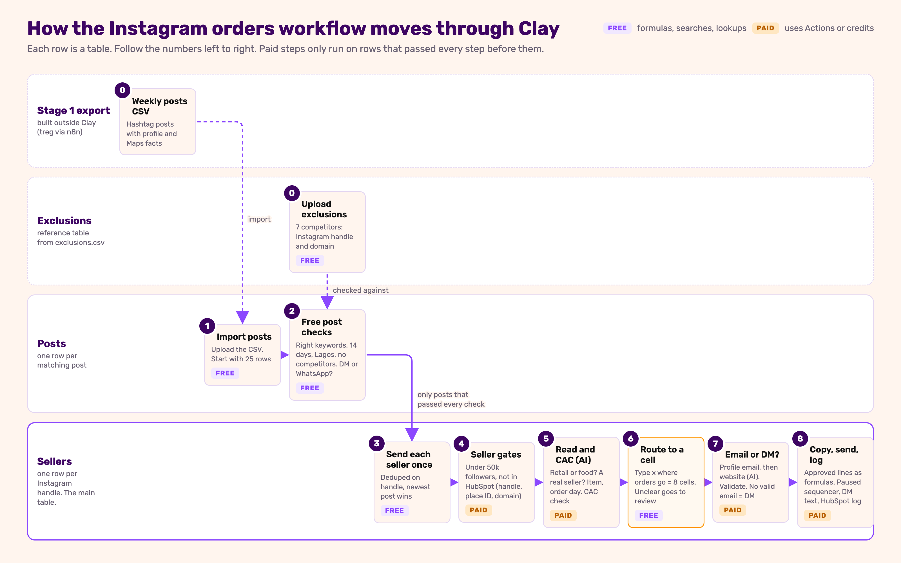

# Clay Build Guide: Lagos sellers and food businesses taking orders on Instagram (Ello)

A step-by-step guide to building `output/campaigns/instagram-order-posts/workflow-spec.md` (Workflow C) in Clay. Written for someone who has never built anything in Clay. Follow the parts in order. Each step tells you **why** it exists, **what to click**, **what to type**, **how to check it worked** and **what it costs**.

> **Updated 2026-11-25:** HubSpot is also checked on `domain`, the only key shared with Workflow B, plus a manual B/C check when there is no domain.
>
> **Updated 2026-11-20** to add the `Exclusions` table (Part 2.3), and to match the spec's pre-build fixes: HubSpot suppression rule and `ello_last_outreach_date`, Lagos regex, competitor handles, posts found on two hashtags, CAC test, coverage rule. See [Things the spec needs to fix](#things-the-spec-needs-to-fix).

> **Don't skip the checks.** The most common Clay mistake is running a column on every row before checking it worked on 1. Every step below ends with a check. If the check fails, fix it before moving on.

---

## Contents

- [What you are building](#what-you-are-building)
- [Clay words you need](#clay-words-you-need)
- [Before you start](#before-you-start)
- [Part 0. Set up the workbook](#part-0-set-up-the-workbook)
- [Part 1. Import the posts](#part-1-import-the-posts)
- [Part 2. Free checks on each post](#part-2-free-checks-on-each-post)
- [Part 3. Sellers table (each seller once)](#part-3-sellers-table)
- [Part 4. Seller gates](#part-4-seller-gates)
- [Part 5. Read the seller (AI) and check CAC](#part-5-read-the-seller-and-check-cac)
- [Part 6. Route each seller to a cell](#part-6-route-each-seller-to-a-cell)
- [Part 7. Email or DM](#part-7-email-or-dm)
- [Part 8. Write the email and DM lines](#part-8-write-the-email-and-dm-lines)
- [Part 9. Views for the operator](#part-9-views-for-the-operator)
- [Part 10. Send and log (build it, don't run it)](#part-10-send-and-log)
- [What it costs](#what-it-costs)
- [Final checklist](#final-checklist)
- [When something goes wrong](#when-something-goes-wrong)
- [Things the spec needs to fix](#things-the-spec-needs-to-fix)

---

## What you are building

The spec says: find **Lagos retail sellers and food businesses that posted on Instagram in the last 14 days telling customers to order by message** ("DM to order", "WhatsApp to order", "orders open", "pre-order"), on Lagos vendor or food hashtags. Keep small accounts (under 50k followers) that aren't competitors or already contacted by any Ello campaign. Sort each one into one of **8 cells** (retail or food x where orders go: DM, WhatsApp, both or not stated). Then either send the approved **3-email sequence** (days 0, 3 and 8) if a valid email exists, or prepare **one Instagram DM** for a person to send by hand.

The posts are collected **outside Clay** (spec Section 3, "Stage 1"), because Clay can't call treg. You import that export, and Clay does everything after it.

You will build **2 tables** inside **1 workbook**, fed by **1 CSV** you import, plus a small `Exclusions` reference table from `exclusions.csv` (the competitors to block):



Each row of the picture is a table. The numbers are the order you build in. Step 0 is the CSV made outside Clay.

Why this shape:
- **Signal first**, because the trigger is a dated event: an Instagram post. One row per post comes in, and the cheap checks (keywords, date, Lagos) run there.
- **Seller checks happen once per seller.** A busy seller may post three times in two weeks. You pay once to read and check them, and they get one sequence or one DM, not three (spec Section 7).
- **Everything paid runs last**, and only on rows that passed every free check before it.
- **Matching uses the Instagram handle, not a website domain.** Clay normally matches on domain, but most of these sellers have no website. The spec (Section 6) keys every seller on their handle, and checks HubSpot on the handle, the Maps place ID and the domain. Only the domain is also written by Workflow B.

What a finished row in **Sellers** looks like, reading left to right (made-up example):

| Handle | Business | Type | Where orders go | Item | Order day | Cell | CAC | Branch | E1 L1 |
|---|---|---|---|---|---|---|---|---|---|
| acmekitchen | Acme Kitchen | s2_food | whatsapp | small chops trays | Friday | S2 x whatsapp | found | email | You're taking Friday orders for small chops trays, so the menu questions are probably coming in already. |

---

## Clay words you need

| Word | What it means |
|---|---|
| **Workbook** | A folder of tables for one campaign. |
| **Table** | A spreadsheet. One row per post, or one row per seller. |
| **Source** | Where a table's rows come from (a CSV, a search, another table). |
| **Column** | One piece of information per row. Three kinds matter: **plain** (you type or import it), **formula** (Clay calculates it, free), **enrichment / action** (Clay calls a provider or AI, usually costs). |
| **Formula** | A small calculation, like a spreadsheet formula. Free. Clay has an AI helper: describe what you want in plain English and it writes the formula. |
| **Use AI** | An AI column that reads the row's data and answers a question. Costs Actions plus a small AI cost. |
| **Claygent** | An AI column that also **browses websites**. Costs more than Use AI. Used here for the CAC check and for finding an email on a website. |
| **Lookup** | A column that reads matching rows from another table in your workbook. Free. |
| **Send table data** | A column that copies rows from this table into another table. Free. |
| **Run condition** ("Only run if") | A rule on a paid column: it only runs on rows where the rule is true. This is how you avoid paying for rows you'll throw away. |
| **Auto-run** | When on, new columns run on every row by themselves. **Keep it off** while building. |
| **Actions** | Clay's main usage meter. About 1 Action per enrichment or AI column per row. Unused Actions expire monthly. |
| **Data Credits** | A second meter, used when Clay pays a data provider for you. |
| **View** | A saved filter on a table, like "ready to email". |
| **Checkbox column** | A plain column you tick by hand. Used here for review decisions and for "DM sent". |
| **Branch** | This build's word, from the spec: `email` if the seller has a valid email, `dm` if not. |

---

## Before you start

Tick these off **before** the session. None of them should be done live.

- [ ] **Clay account** with access to the workspace you'll build in. Note the plan (Settings → Plans & billing) and how many Actions are left. See [What it costs](#what-it-costs).
- [ ] **HubSpot connected to Clay** (Settings → Connections → HubSpot). In HubSpot, make sure these company properties exist. `ello_last_outreach_date` and HubSpot's built-in `domain` (don't create it) are shared with Workflow B (hiring a customer service rep); if Workflow B's build created them already, don't create them twice.
  - `instagram_handle` (single-line text)
  - `maps_place_id` (single-line text)
  - `ello_last_outreach_date` (**date picker**). Both workflows write it on every contact. It drives the 90-day rule, because a logged HubSpot note doesn't update "last contacted".
  - Also confirm the internal names of two built-in properties: lifecycle stage (expected `lifecyclestage`) and number of open deals (expected `hs_num_open_deals`). HubSpot → Settings → Properties → Company → click the property → the internal name is under its label. If either differs, use the real name in Part 4.2 and tell the spec owner.
- [ ] **`exclusions.csv`** from this folder (`output/campaigns/instagram-order-posts/clay-build/`): 7 competitors with domain, Instagram handle and source. Four handles are known (CallAI's parent, PressOne, Bumpa, Fresha). Zana, Obeks and NativeTalk have no Instagram linked on their sites; if you find their accounts, add them to the spec first, then to this CSV. You import it in Part 2.3. Don't add guessed domains or handles.
- [ ] **CAC test, before the build test.** Pick 5 Lagos businesses you already know are CAC-registered. You'll run the Part 5.3 Claygent on them first. If it can't read the CAC search results, you'll do the CAC check by hand instead.
- [ ] **The spec is open** next to you: `output/campaigns/instagram-order-posts/workflow-spec.md`. Sections 2 (who's in and out), 3 (sources), 4 (signals), 5 (cells), 6 (variables) and the Copy section are what you're building.
- [ ] **The Stage 1 CSV is ready.** Stage 1 isn't built yet (spec Section 3). For this first test, run one treg pull on one S1 hashtag and one S2 hashtag (check the price before each call), fetch the profiles of matching accounts, or fill the CSV by hand from 25 real posts. It must have exactly these 16 columns, in any order:

  `hashtag, post_url, post_date, caption, post_location, instagram_handle, display_name, bio, followers, is_business, ig_category, public_email, bio_link, maps_place_id, maps_category, maps_website`

  `post_date` must be written `YYYY-MM-DD`. `hashtag` is the hashtag the post was found on (for example `lagosbaker`). **If the same post was found on more than one hashtag, write one row for it and put every hashtag in that cell, separated by commas** (for example `lagosvendor,lagosbaker`). Clay keeps only one row per post, so this is how a post found on both an S1 and an S2 hashtag keeps both. Fill `maps_place_id` only when the Maps listing links to the same Instagram handle, or its name matches the cleaned business name exactly and its address is in Lagos. Leave a cell empty when the fact wasn't found. Never guess.
- [ ] **Test size: 25 posts.** The spec's email coverage test needs more sellers than 25 posts will give. Treat this run as a build test.
- [ ] **For the DM branch:** the Ello Instagram account that sends DMs, and a daily cap on DMs, are still NEEDS INPUT in the spec. You can build everything without them; nobody sends a DM until they're decided.
- [ ] **Sequencer:** not chosen yet. Part 10's email push waits until it is.

---

## Part 0. Set up the workbook

**Why:** one place for everything in this campaign.

1. In Clay, click **+ New** (top left) → **Workbook**.
2. Name it: `Ello · Instagram order posts · Lagos`.
3. In the workbook description, paste: *"Signal: Lagos retail and food sellers who posted 'DM to order', 'WhatsApp to order' or 'orders open' on Instagram in the last 14 days. Spec: ello-gtm-os/output/campaigns/instagram-order-posts/workflow-spec.md. Rows come from the Stage 1 CSV (built outside Clay). Email (3 emails, days 0/3/8) or 1 manual Instagram DM."*

**Check:** the workbook appears in your Clay home with that name.
**Cost:** free.

---

## Part 1. Import the posts

**Why:** this is the trigger (spec Section 1). Each row is one post found by the Stage 1 pull.

### 1.1 Import

1. Inside the workbook, click **+ Add table** → **Import CSV**.
2. Upload the Stage 1 CSV. Name the table `Posts`.
3. **Turn Auto-run OFF**: table settings (the ⚙ or "…" menu) → **Auto-update / Auto-run** → off. Do this before adding any column.

### 1.2 Tidy the columns

Rename each column (column header → **Edit column**):

| CSV column | Rename to | Data type |
|---|---|---|
| hashtag | `Hashtag` | Text |
| post_url | `Post URL` | URL |
| post_date | `Post Date` | Date (or Text if Date won't take it) |
| caption | `Caption` | Text |
| post_location | `Post Location` | Text |
| instagram_handle | `Instagram Handle` | Text |
| display_name | `Display Name` | Text |
| bio | `Bio` | Text |
| followers | `Followers` | Number |
| is_business | `Is Business` | Text |
| ig_category | `IG Category` | Text |
| public_email | `Profile Email` | Email |
| bio_link | `Bio Link` | URL |
| maps_place_id | `Maps Place ID` | Text |
| maps_category | `Maps Category` | Text |
| maps_website | `Maps Website` | URL |

### 1.3 Remove duplicates

Table settings → **Deduplicate** → choose `Post URL`. A post found on two hashtags is kept once (Stage 1 should already have merged it into one row with both hashtags; this is the safety net).

**Check:** 25 rows (fewer if some were duplicates). Open 3 `Post URL`s and confirm each post's caption and date match the row.
**Cost:** free.

---

## Part 2. Free checks on each post

**Why:** drop the posts we know are wrong **before** spending anything (spec Sections 2 and 4, signals 1, 3 and 6). Everything here is a formula, so it's free.

**How to add a formula column:** **+ Add column** → **Formula**. Type the formula, or click **Use AI** inside the formula box and describe it in plain English. Type `/` to insert another column. Below, columns are written `{{Column Name}}`. Paste the plain English into the column's description too.

### 2.1 Clean the handle and the name

| Column | Plain English for the AI helper | Formula |
|---|---|---|
| `Handle` | Instagram Handle in lowercase, without the @ and without spaces | `({{Instagram Handle}} \|\| "").replace(/^@/, "").replace(/\s+/g, "").toLowerCase()` |
| `Business Name` | Display Name without emojis, cut at the first \| or •, or at a dash with spaces on both sides, without Ltd or Limited at the end. If that leaves nothing, the Handle with underscores and dots turned into spaces | `(({{Display Name}} \|\| "").replace(/[\u{1F000}-\u{1FAFF}\u{2600}-\u{27BF}\u{FE0F}]/gu, "").split(/\s*[\|•]\s*\|\s+[-–]\s+/)[0].replace(/\s+(ltd\|limited)\.?$/i, "").trim()) \|\| {{Handle}}.replace(/[_.]+/g, " ").trim()` |

**Check:** "Acme Kitchen 🍢 \| Small chops in Lekki" becomes `Acme Kitchen`. "Jay-Jay Foods" stays `Jay-Jay Foods`.

### 2.2 The trigger (signal 1)

The keyword list depends on **which hashtag the post was found on**, not on what the business turns out to be (spec Section 2). A post found on both an S1 and an S2 hashtag passes if its caption matches **either** list.

| Column | Plain English | Formula |
|---|---|---|
| `Hashtag Set` | Split Hashtag on commas (ignore a leading # and spaces). "both" if it includes an S1 tag (lagosvendor, lagosboutique, shopinlagos, lagosthriftstore) and an S2 tag (smallchopsinlagos, lagosbaker, lagosfoodvendor); "s1" if only S1; "s2" if only S2; blank otherwise | `(() => { const t = ({{Hashtag}} \|\| "").split(",").map(x => x.trim().replace(/^#/, "").toLowerCase()); const a = t.some(x => ["lagosvendor","lagosboutique","shopinlagos","lagosthriftstore"].includes(x)); const b = t.some(x => ["smallchopsinlagos","lagosbaker","lagosfoodvendor"].includes(x)); return a && b ? "both" : a ? "s1" : b ? "s2" : ""; })()` |
| `Keyword Match?` | S1 list: dm to order, send a dm, whatsapp to order, price in dm (or price in the dm), dm for price. S2 list: orders open (or orders are open, orders now open), pre-order or preorder, taking orders, today's menu, this week's menu, weekly menu, dm to order, whatsapp to order. True if Hashtag Set is s1 and the caption matches the S1 list; or s2 and it matches the S2 list; or both and it matches either | `(() => { const c = {{Caption}} \|\| ""; const k1 = /\b(dm to order\|send a dm\|whatsapp to order\|price in (the )?dm\|dm for price)\b/i.test(c); const k2 = /\b(orders? (are )?(now )?open\|pre-?orders?\|taking orders\|(today'?s\|this week'?s\|weekly) menu\|dm to order\|whatsapp to order)\b/i.test(c); const s = {{Hashtag Set}}; return s === "s1" ? k1 : s === "s2" ? k2 : s === "both" ? (k1 \|\| k2) : false; })()` |
| `Days Since Post` | Whole days between Post Date and today; blank if there's no date | `{{Post Date}} ? Math.floor((Date.now() - new Date({{Post Date}}).getTime()) / 86400000) : null` |

**Check:** a #lagosvendor post saying "Send a DM to order" → true. A #lagosbaker post saying "Pre-orders open for Friday" → true. A #lagosvendor post saying only "orders open" → false (that phrase is only on the food list). The same post with Hashtag `lagosvendor,lagosbaker` → `Hashtag Set` = both, `Keyword Match?` = true. If Clay rejects the `(() => { … })()` form, paste the plain English into the AI helper and check these 4 cases.

### 2.3 Lagos and competitors (spec Section 2)

**First, the `Exclusions` table.** It holds the competitors to block, so the list lives in one place instead of inside a formula.

1. **+ Add table** → **Import CSV** → upload `exclusions.csv` (Before you start). Name the table `Exclusions`. Turn **Auto-run off**.
2. Keep the 6 columns as they are: `Company Name`, `Legal Entity`, `Domain`, `Instagram Handle`, `Type`, `Source`. Domains are written plain (`getbumpa.com`, no `https://` or `www.`) and handles lowercase without "@", so they match the formulas below.
3. **Check:** 7 rows; 6 with a domain (Fresha's is blank on purpose, see below); 4 with an Instagram handle.

> **Why Fresha has no domain (fixed 2026-11-21):** Fresha is a booking platform. Salons put their Fresha booking page (`fresha.com/...`) in their bio or Maps listing, so matching on `fresha.com` would block real salons as competitors. Fresha is matched on its handle (`fresha`) only. Don't add `fresha.com` back.

Then, back in `Posts`, two free formulas that turn the post's links into the same shape as the `Domain` column:

| Column | Plain English | Formula |
|---|---|---|
| `Bio Link Domain` | The Bio Link without https://, www. or anything after the first /, in lowercase; blank if there's no link | `({{Bio Link}} \|\| "").trim().toLowerCase().replace(/^https?:\/\//, "").replace(/^www\./, "").split(/[\/?#]/)[0]` |
| `Maps Domain` | The same for Maps Website | `({{Maps Website}} \|\| "").trim().toLowerCase().replace(/^https?:\/\//, "").replace(/^www\./, "").split(/[\/?#]/)[0]` |
| `Company Domain` | Maps Domain if it's the business's own site, otherwise Bio Link Domain if it is, otherwise blank. Shared hosts (link pages, social networks, WhatsApp and Fresha booking pages) don't count | `[{{Maps Domain}}, {{Bio Link Domain}}].find(d => !!d && !/(^\|\.)(linktr\.ee\|beacons\.ai\|bio\.link\|bit\.ly\|wa\.me\|wa\.link\|whatsapp\.com\|instagram\.com\|facebook\.com\|fb\.com\|tiktok\.com\|x\.com\|twitter\.com\|youtube\.com\|t\.me\|google\.com\|goo\.gl\|fresha\.com)$/i.test(d)) \|\| ""` |

Then three lookups (free). For each: **+ Add column** → **Lookup single row in other table** (may be called "Lookup row") → table `Exclusions` → match the column below → add the run condition.

| Column | Match `Exclusions` column | To this value | Run condition |
|---|---|---|---|
| `Excluded by Handle` | `Instagram Handle` | `{{Handle}}` | `!!{{Handle}}` |
| `Excluded by Bio Domain` | `Domain` | `{{Bio Link Domain}}` | `!!{{Bio Link Domain}}` |
| `Excluded by Maps Domain` | `Domain` | `{{Maps Domain}}` | `!!{{Maps Domain}}` |

> **Why the run conditions matter:** three competitors have no Instagram handle in the CSV, and Fresha has no domain. A lookup run on a blank value can match those blank rows and block a seller by mistake. Only run each lookup when its value is filled.

Now the two checks:

| Column | Plain English | Formula |
|---|---|---|
| `In Lagos?` | True if the Bio or Post Location names Lagos or one of the Lagos areas in the spec's list | `/lagos\|lekki\|ikeja\|yaba\|surulere\|ajah\|ikoyi\|victoria island\|festac\|gbagada\|ikorodu\|magodo\|ogba\|oshodi\|egbeda\|ojodu\|ilupeju\|isolo\|apapa\|sangotedo\|chevron/i.test(({{Bio}} \|\| "") + " " + ({{Post Location}} \|\| ""))` |
| `Competitor?` | True if any of the three Exclusions lookups found a row | `!!{{Excluded by Handle}} \|\| !!{{Excluded by Bio Domain}} \|\| !!{{Excluded by Maps Domain}}` |

> **Why these changed (2026-11-20):** `maryland` (also a US state) and `vi` (any standalone "vi") were dropped from the Lagos list; "Maryland, Lagos" still passes on "lagos". The competitor check is an exact match on handle or domain against the `Exclusions` table, never a match on names ("zana" would block unrelated sellers). Four handles are confirmed (2026-11-20); Zana, Obeks and NativeTalk are still NEEDS INPUT in the spec, and are caught by domain meanwhile.

> **Existing Ello users** are excluded in the spec but **not active in v1**: it turns on when the Ello team sends a list of sign-up handles. When it arrives, add those accounts to the `Exclusions` table with `Type` = `ello_user` and their Instagram handle (and domain where known); the lookups above block them too.

**Check:** read 5 rows where `In Lagos?` is false. Is any of them really in Lagos? If an area is missing, add it to the spec's list first, then here. Then read 5 rows where it's true and make sure none is outside Lagos. For `Competitor?`, add one test row to `Posts` with Instagram Handle `@GetBumpa` and one with Bio Link `https://www.pressone.africa/`: both must show `Competitor?` true. Add one with Bio Link `https://www.fresha.com/a/test-salon`: it must show `Competitor?` false (a salon's booking link is not a competitor). A row with no handle and no links: all three lookups stay empty (they didn't run). Delete the test rows.

### 2.4 Where orders go (signal 3, a router) and personal number (signal 6)

| Column | Plain English | Formula |
|---|---|---|
| `DM in Caption?` | True if the caption mentions DM or DMs, send a dm, direct message, inbox us, inbox me or price in (the) dm | `/\bdms?\b\|send a dm\|direct message\|inbox (us\|me)\|price in (the )?dm/i.test({{Caption}} \|\| "")` |
| `WhatsApp in Caption?` | True if the caption mentions whatsapp or wa.me | `/whatsapp\|wa\.me/i.test({{Caption}} \|\| "")` |
| `WhatsApp in Bio?` | True if the bio has a wa.me or api.whatsapp.com link or the word whatsapp | `/wa\.me\|api\.whatsapp\.com\|whatsapp/i.test({{Bio}} \|\| "")` |
| `Where Orders Go` | WhatsApp counts if the caption says it, or if the caption names neither DM nor WhatsApp and the bio does. Then "both" if DM and WhatsApp, "dm" if only DM, "whatsapp" if only WhatsApp, otherwise "not_stated" | `(() => { const d = {{DM in Caption?}} === true; const w = {{WhatsApp in Caption?}} === true \|\| (!{{DM in Caption?}} && !{{WhatsApp in Caption?}} && {{WhatsApp in Bio?}} === true); return d && w ? "both" : d ? "dm" : w ? "whatsapp" : "not_stated"; })()` |
| `Personal Number?` | True if the bio, with spaces and dashes removed, contains a Nigerian mobile number (+234 or 0, then 7, 8 or 9, then 0 or 1, then 8 digits) | `/(\+?234\|0)[789][01]\d{8}/.test(({{Bio}} \|\| "").replace(/[\s-]/g, ""))` |

> If Clay rejects the `(() => { … })()` form in `Where Orders Go`, paste the plain English into the AI helper and let it write the formula. Check it against the 4 cases in the Check below.

**Check:** caption "DM to order", bio with a wa.me link → `dm` (the caption names DM, so the bio isn't used). Caption "Pre-orders open", bio with a wa.me link → `whatsapp`. Caption "DM or WhatsApp to order" → `both`. Caption "Orders open", no WhatsApp in bio → `not_stated`. `Personal Number?` never shows the number itself.

### 2.5 `Post Pass?`

- Plain English: *"True if Keyword Match and In Lagos are true, Days Since Post is 14 or less, and Competitor is false."*
- Formula:
```javascript
{{Keyword Match?}} === true && {{In Lagos?}} === true && {{Days Since Post}} !== null && {{Days Since Post}} <= 14 && !{{Competitor?}}
```

**Check:** sort by `Post Pass?`. Open every "false" row and make sure each one deserves to be out.
**Cost:** free.

---

## Part 3. Sellers table

**Why:** everything from here is checked and sent **once per seller** (spec Section 3, "One row per account").

### 3.1 Create the empty table

1. **+ Add table** → **Blank table**. Name it `Sellers`.
2. Add these columns: `Handle`, `Business Name`, `Hashtag Set`, `Caption`, `Post URL` (URL), `Post Date`, `Bio`, `Followers` (Number), `Is Business`, `IG Category`, `Profile Email` (Email), `Bio Link` (URL), `Maps Place ID`, `Maps Category`, `Maps Website` (URL), `Where Orders Go`, `Personal Number?`, `Company Domain`.
3. Table settings → **Deduplicate** → choose `Handle`.
4. Turn **Auto-run off** here too.

### 3.2 Send sellers over from Posts

Back in `Posts`:

1. **Sort** the table by `Post Date`, newest first. Clay keeps the first row it receives for each handle, so this makes the **newest post** the one that sets the item, the order day and where orders go (spec Section 3).
2. **+ Add column** → **Send table data** (sometimes "Write to table").
3. Destination: `Sellers`. Map each column in 3.1 to the column of the same name in `Posts`.
4. **Run condition:** `{{Post Pass?}} === true`.
5. Run on **1 row** first. Open `Sellers` and check every field arrived.
6. Then run on the rest.

**Check:** `Sellers` has no duplicate handles. For a seller with two posts in `Posts`, the row in `Sellers` shows the newer caption.
**Cost:** free.

---

## Part 4. Seller gates

**Why:** spec Section 2 keeps accounts under 50k followers that no Ello campaign has contacted in 90 days. These run before any AI.

### 4.1 `Followers OK?`

| Column | Plain English | Formula |
|---|---|---|
| `Followers OK?` | True if Followers is a number under 50,000 | `{{Followers}} !== null && {{Followers}} !== "" && Number({{Followers}}) < 50000` |

> A blank follower count fails here, because the spec's size rule can't be checked without it. Those rows show up in the `Dropped` view (Part 9) so you can see if Stage 1 is missing profiles. See [Things the spec needs to fix](#things-the-spec-needs-to-fix).

### 4.2 HubSpot lookups (shared with Workflow B)

**Why three lookups:** the spec (Sections 2 and 6) checks HubSpot in order: handle, Maps place ID, domain. Workflow B writes only the domain, so that lookup is what skips a business it already contacted.

| Column | HubSpot property to match | Value | Run condition |
|---|---|---|---|
| `HubSpot by Handle` | `instagram_handle` | `{{Handle}}` | `{{Followers OK?}} === true` |
| `HubSpot by Place ID` | `maps_place_id` | `{{Maps Place ID}}` | `{{Followers OK?}} === true && !!{{Maps Place ID}} && !{{HubSpot by Handle}}` |
| `HubSpot by Domain` | `domain` | `{{Company Domain}}` | `{{Followers OK?}} === true && !!{{Company Domain}} && !{{HubSpot by Handle}} && !{{HubSpot by Place ID}}` |

For each: **+ Add column** → search **HubSpot** → **Lookup company** (may be called "Find object" or "Lookup object"; choose the Company object) → set the property and value → add the run condition.

In each lookup, ask for these properties back: `lifecyclestage`, `hs_num_open_deals`, `ello_last_outreach_date` (or the real internal names you confirmed in Before you start).

1. Run each on **1 row** first. An empty cell means HubSpot has no such company, which is expected for most rows.
2. Formula `In HubSpot?`. Plain English: *"True if any of the three HubSpot lookups found a company whose lifecycle stage is customer, OR whose number of open deals is above 0, OR whose ello_last_outreach_date is within the last 90 days."* This is the spec's suppression rule (Section 2). A starting formula:
```javascript
[{{HubSpot by Handle}}, {{HubSpot by Place ID}}, {{HubSpot by Domain}}].some(c => !!c && (
  c.lifecyclestage === "customer" ||
  Number(c.hs_num_open_deals || 0) > 0 ||
  (!!c.ello_last_outreach_date && (Date.now() - new Date(c.ello_last_outreach_date).getTime()) / 86400000 <= 90)
))
```
   Clay may nest the properties differently (for example under `properties`). Open a cell that has a match and adjust the paths, or let the AI helper rewrite it from the plain English. To get a match, add a test company in HubSpot with a known `instagram_handle` and test it three times: as a customer, with an open deal, and with `ello_last_outreach_date` set to last week. Each time `In HubSpot?` must be true. Set the date to 100 days ago with no deal and a non-customer stage: it must be false. Delete the test company afterwards.

**Cost:** check the Actions counter before and after the 1-row run. Some plans charge per CRM lookup.

### 4.3 `Pass Seller Gates?`

| Column | Plain English | Formula |
|---|---|---|
| `Pass Seller Gates?` | True if Followers OK is true and In HubSpot is not true | `{{Followers OK?}} === true && {{In HubSpot?}} !== true` |

**Check:** filter `Pass Seller Gates?` = false and read why each is out.

---

## Part 5. Read the seller and check CAC

### 5.1 `Seller Read (AI)`: Use AI (signals 2, 4, 5 and the seller check)

**Why AI:** the business type routes the copy (spec Section 5), and a food vendor on #lagosvendor or a fashion school on #lagosboutique can't be sorted reliably by keywords. One column reads everything the spec needs, so you pay for one AI call per seller.

1. **+ Add column** → **Use AI**.
2. Prompt:
   > *You are reading the Instagram account of a Lagos business that posted asking customers to order by message.*
   >
   > *Business name: {{Business Name}}. Instagram category: {{IG Category}}. Google Maps category: {{Maps Category}}. Bio: {{Bio}}. Latest post caption: {{Caption}}. Hashtag group (a hint only): {{Hashtag Set}}*
   >
   > *1. segment: one of:*
   > *"s1_retail": sells products to the public (for example clothes, shoes, bags, cosmetics, phones, gadgets, home goods, thrift items).*
   > *"s2_food": sells food or drinks (restaurant, takeout, small chops, cakes and pastries, catering, meal trays, drinks).*
   > *"s3_salon": hair, nails, lashes, barbing, make-up or spa services.*
   > *"clinic": any healthcare service.*
   > *"other": anything else, such as fashion or baking schools, courses, influencers, event planners, agencies, logistics.*
   > *"unclear": the information above isn't enough to tell. Don't guess from the hashtag alone.*
   >
   > *2. is_seller: "yes" if the bio shows this account sells something (a product, a price, ordering instructions, a shop or a WhatsApp ordering link), "no" if it is a personal account that doesn't sell, "unclear" if you can't tell.*
   >
   > *3. item: what the latest post is selling, as a short lowercase noun phrase taken from the caption, such as "ankara dresses" or "small chops trays". No price, no emoji, no brand hype. Empty if the caption doesn't name one.*
   >
   > *4. order_day: only if the caption says which day orders are for, that day's name in English with a capital letter, such as "Friday". Empty if the caption gives no day, or gives only a date.*
   >
   > *5. owner_first_name: the owner's first name only if the bio names the owner (for example "CEO: Ada" or "by Chioma"). Empty otherwise. Never guess from the handle.*
   >
   > *6. evidence: a short quote from the bio or caption that supports the segment.*
3. Output format: **JSON**, with exactly these fields:
   - `segment`: text, one of `s1_retail`, `s2_food`, `s3_salon`, `clinic`, `other`, `unclear`
   - `is_seller`: text, one of `yes`, `no`, `unclear`
   - `item`: text
   - `order_day`: text, one of `Monday`, `Tuesday`, `Wednesday`, `Thursday`, `Friday`, `Saturday`, `Sunday`, or empty
   - `owner_first_name`: text
   - `evidence`: text
4. **Run condition:** `{{Pass Seller Gates?}} === true`
5. Run on **3 sellers you can judge yourself**: one clothing or gadget seller, one food vendor whose caption names a day, and one account you think is a school, influencer or personal page. Read every field. If one is wrong, fix the prompt and re-run the same 3.
6. Then run on the rest.

**Cost:** about **1 Action plus a small AI cost per seller**.

### 5.2 Helper columns

Two plain columns first, for a reviewer to fill in:
- `Segment Override` (Text): empty unless a reviewer decides an `unclear` seller. Only `s1_retail` or `s2_food`.
- `CAC Override` (Checkbox): unticked unless a reviewer confirms CAC registration by hand (5.3).

| Column | Plain English | Formula |
|---|---|---|
| `Segment` | Segment Override if filled, otherwise the AI's segment, otherwise "unclear" | `{{Segment Override}} \|\| {{Seller Read (AI)}}?.segment \|\| "unclear"` |
| `In Segment?` | True if Segment is s1_retail or s2_food | `["s1_retail", "s2_food"].includes({{Segment}})` |
| `Seller OK?` | True if Is Business says true; otherwise true only if the AI's is_seller is yes | `String({{Is Business}} \|\| "").toLowerCase() === "true" \|\| {{Seller Read (AI)}}?.is_seller === "yes"` |
| `Item` | The AI's item, or blank | `({{Seller Read (AI)}}?.item \|\| "").trim()` |
| `Order Day` | The AI's order day, only for food sellers and only if it is a day name; otherwise blank | `{{Segment}} === "s2_food" && /^(Monday\|Tuesday\|Wednesday\|Thursday\|Friday\|Saturday\|Sunday)$/.test({{Seller Read (AI)}}?.order_day \|\| "") ? {{Seller Read (AI)}}.order_day : ""` |
| `First Name` | The AI's owner first name; if blank, Business Name followed by " team" | `({{Seller Read (AI)}}?.owner_first_name \|\| "").trim() \|\| ({{Business Name}} + " team")` |

> **What `unclear` means:** an `unclear` segment, or an `unclear` / `no` seller check, never gets a cell and never gets an email or DM (spec Sections 2 and 5). `unclear` rows go to review views (Part 9). A reviewer fills `Segment Override`, or leaves the row out.

**Check:** filter `In Segment?` = true and read every `evidence`. Would you agree?

### 5.3 `CAC Check`: Claygent (registration review)

**Why:** the spec wants CAC-registered businesses. CAC's public search is a website form, so only a browsing AI or a person can check it. In v1 it's a **review step**. Matching an Instagram name to CAC is fuzzier than a company name, so expect more `unclear` answers than in Workflow B.

1. **+ Add column** → **Claygent**.
2. Prompt:
   > *Go to the Corporate Affairs Commission (CAC) public search for Nigeria (search.cac.gov.ng; if that address doesn't work, search the web for "CAC public search"). Search for the business name "{{Business Name}}".*
   >
   > *1. cac_status: "found" if a registered business or company with this name, or a very close match, appears. "not_found" if nothing close appears. "unclear" if the site didn't load, asked for a login or a captcha, or several different businesses match.*
   >
   > *2. registered_name: the name exactly as CAC shows it. Empty if not found.*
   >
   > *3. registration_number: the RC or BN number CAC shows. Empty if not found.*
   >
   > *4. evidence: one line on what you saw. Don't guess.*
3. Output format: **JSON**: `cac_status` (one of `found`, `not_found`, `unclear`), `registered_name`, `registration_number`, `evidence`.
4. **Run condition:** `{{Pass Seller Gates?}} === true && {{In Segment?}} === true && {{Seller OK?}} === true`
5. **First, the CAC test (spec Section 3):** add the 5 known CAC-registered businesses from Before you start as test rows (or temporarily point the prompt at their names) and run on those 5. If Claygent doesn't return `found` for them, it can't read the CAC site: **stop**, delete the column and check by hand, ticking `CAC Override`. Delete the test rows afterwards.
6. If the test passes, run on **2 or 3 real sellers** you've checked yourself, then on the rest.

> **Open decision (spec Section 4):** Instagram trading names often don't match CAC names, so many sellers may land in `Review: CAC`. For now a CAC miss blocks the seller until a reviewer ticks `CAC Override` (that's what `Ready to Contact?` in Part 6 does). If the team decides after the test to send and only flag, remove `{{CAC OK?}} === true` from `Ready to Contact?`.

| Column | Plain English | Formula |
|---|---|---|
| `CAC OK?` | True if the CAC check says found, or a reviewer ticked CAC Override | `{{CAC Check}}?.cac_status === "found" \|\| {{CAC Override}} === true` |

**Cost:** more per row than Use AI (it browses). Only runs on gate-passing retail and food sellers.

---

## Part 6. Route each seller to a cell

### 6.1 `Cell`

The spec's 8 cells are segment (2) x where orders go (4).

- Plain English: *"If In Segment is false, leave blank. Otherwise S1 for s1_retail or S2 for s2_food, then ' x ', then Where Orders Go. For example 'S2 x whatsapp'."*
```javascript
!{{In Segment?}} ? "" : ({"s1_retail": "S1", "s2_food": "S2"})[{{Segment}}] + " x " + {{Where Orders Go}}
```

### 6.2 `Ready to Contact?`

- Plain English: *"True if Pass Seller Gates, Seller OK and CAC OK are true and Cell is not empty."*
```javascript
{{Pass Seller Gates?}} === true && {{Seller OK?}} === true && {{Cell}} !== "" && {{CAC OK?}} === true
```

**Check:** filter `Ready to Contact?` = true. Open every row's `Post URL`. Would you be happy for each of these sellers to hear from Ello? Count rows per cell: with 25 posts, several cells will be empty, and that's fine. `S1 x not_stated` should be rare (spec Section 5).
**Cost:** free.

---

## Part 7. Email or DM

**Why:** the spec (Sections 3 and 7) uses email when a valid one exists, and one manual Instagram DM otherwise. The order: **(a)** the public email on the profile (already in the CSV, free); **(b)** Claygent on the bio link or Maps website, only when (a) is empty and the link can hold an email.

### 7.1 Which website to check

| Column | Plain English | Formula |
|---|---|---|
| `Site To Check` | The Bio Link if it isn't a wa.me, api.whatsapp.com or instagram.com link; otherwise the Maps Website if it isn't one of those; otherwise blank | `[{{Bio Link}}, {{Maps Website}}].find(u => !!u && !/wa\.me\|api\.whatsapp\.com\|instagram\.com/i.test(u)) \|\| ""` |

### 7.2 `Website Email`: Claygent, only when there's no profile email

1. **+ Add column** → **Claygent**.
2. Prompt:
   > *Visit {{Site To Check}}. Find an email address for {{Business Name}} that is written on the page or the site's contact page. Only return an address you can see. Never guess or build one from a name.*
   >
   > *1. email: the address, or empty if there isn't one.*
   >
   > *2. page_url: the page where you saw it.*
3. Output format: **JSON**: `email`, `page_url`.
4. **Run condition:** `{{Ready to Contact?}} === true && !{{Profile Email}} && !!{{Site To Check}}`
5. Run on **1 row**, open `page_url` and check the email is really there. Then the rest.

### 7.3 `Email`, validation and `Branch`

| Column | Plain English | Formula |
|---|---|---|
| `Email` | Profile Email if there is one, otherwise the email Claygent found, in lowercase; otherwise blank | `(({{Profile Email}} \|\| {{Website Email}}?.email \|\| "") + "").trim().toLowerCase()` |

Then validate:
1. **+ Add column** → search **validate email** (may be listed under a provider, for example ZeroBounce, NeverBounce or Debounce). Input `{{Email}}`.
2. **Run condition:** `{{Ready to Contact?}} === true && !!{{Email}}`
3. Run on **1 row**, read the status, then the rest. **Add as column**: `Email Status`.

| Column | Plain English | Formula |
|---|---|---|
| `Branch` | Blank if Ready to Contact is false. Otherwise "email" if there is an Email and Email Status is valid, else "dm" | `!{{Ready to Contact?}} ? "" : (!!{{Email}} && {{Email Status}} === "valid") ? "email" : "dm"` |

**Check:** count `Branch` = email and `Branch` = dm. **Write both numbers down**: that's the start of the spec's email coverage test, and it tells you how much manual DM work this list makes. The full coverage test (every matching post from the last 14 days on all 7 hashtags) uses the spec's decision rule: if the DM-branch sellers per week are more than the daily DM cap can send in a week, the team decides before launch whether to raise the cap, add a sender, or drop the oldest posts from the DM queue.
**Cost:** Claygent more per row than Use AI, only where no profile email exists and a usable site does. Validation about **1 Action per email** (plus Data Credits if Clay pays the provider).

---

## Part 8. Write the email and DM lines

**Why:** the approved copy (spec Copy section) has lines that change per seller. Every version is already written and approved, so **these are formulas, not AI**: free and identical every time. Email lines only fill on `Branch` = email rows; DM lines only on `Branch` = dm rows. The wording inside the quotes is copied **exactly** from the spec. Don't edit it here: change the spec first.

### 8.1 The spec's lines

For reference while you check the formulas (`{{item}}` is the `Item` column, `{{order_day}}` is `Order Day`):

**`e1l1`** (Email 1, line 1)
| Condition | Line |
|---|---|
| `s1_retail` + `item` | You're selling {{item}} on Instagram, so my guess is the price and stock questions are coming in. |
| `s1_retail`, no `item` | You're taking orders on Instagram, so I'd guess buyers are asking about price and stock. |
| `s2_food` + `item` + `order_day` | You're taking {{order_day}} orders for {{item}}, so the menu questions are probably coming in already. |
| `s2_food` + `item`, no `order_day` | You're taking orders for {{item}}, so I imagine the menu questions are coming in. |
| `s2_food` + `order_day`, no `item` | You're taking {{order_day}} orders, so my guess is customers are already asking what's on the menu. |
| `s2_food`, neither | You're taking food orders on Instagram, so I'd guess customers are asking what's on the menu. |

**`e1l2`** (Email 1, line 2, by cell)
| Cell | Line |
|---|---|
| S1 x dm | The post asks buyers to DM you, so those questions land in your Instagram inbox for you to answer. |
| S1 x whatsapp | The post sends buyers to WhatsApp to order, so each one switches apps before they can ask anything. |
| S1 x both | Buyers can order by DM or on WhatsApp, so the messages arrive in two different places. |
| S1 x not_stated | Buyers who like what they see will want a quick way to ask before they order. |
| S2 x dm | Orders come in by DM, so those questions probably reach your inbox while you're cooking. |
| S2 x whatsapp | Orders go through WhatsApp, so they depend on someone being on that phone. |
| S2 x both | Orders come in by DM and on WhatsApp, so they land in two places at the busiest time. |
| S2 x not_stated | Hungry customers will want one quick place to ask what's left and order. |

**`e2l1`** (Email 2, line 1, by segment)
| Segment | Line |
|---|---|
| `s1_retail` | Chances are you like talking to buyers yourself, since nobody knows your stock better. |
| `s2_food` | Nobody knows your menu better than you, so you may not want an agent talking to your customers. |

**`e3l1`** (Email 3, line 1, by where orders go x personal number)
| Where orders go | Number in bio | Line |
|---|---|---|
| `dm` | no | Your handle lives in your Instagram bio, so buyers who'd normally DM can tap it too. |
| `dm` | yes | Your handle lives in your Instagram bio, and customers reach you without your personal phone number ever being exposed. |
| `whatsapp` | no | The handle sits in your Instagram bio, so customers can chat or call from there without saving a number first. |
| `whatsapp` | yes | The handle sits in your Instagram bio, and customers reach you without your personal phone number ever being exposed. |
| `both` | no | Your handle can sit in your Instagram bio and on a QR code or business card, so every order starts in one place. |
| `both` | yes | Your handle can sit in your Instagram bio and on a QR code, and customers reach you without your personal phone number ever being exposed. |
| `not_stated` | no | The handle can go in your Instagram bio, on your Google profile and in your ads, so there's one obvious place to order. |
| `not_stated` | yes | The handle can go in your Instagram bio and your ads, and customers reach you without your personal phone number ever being exposed. |

**`dm_l1`** (DM, line 1)
| Condition | Line |
|---|---|
| `s1_retail` + `item` | Your post about the {{item}} is why I'm messaging. |
| `s1_retail`, no `item` | Your post about taking orders is why I'm writing. |
| `s2_food` + `item` + `order_day` | Your post about {{order_day}} orders for {{item}} got me writing. |
| `s2_food` + `item`, no `order_day` | I'm messaging because of your post taking orders for {{item}}. |
| `s2_food` + `order_day`, no `item` | Your post about {{order_day}} orders is why I'm getting in touch. |
| `s2_food`, neither | I'm writing because of your post about taking food orders. |

**`dm_q`** (DM question, by where orders go)
| Where orders go | Question |
|---|---|
| `dm` | Want me to set one up, so buyers who DM you have a quicker way to ask and order? |
| `whatsapp` | Should I set one up, so buyers can reach you without switching to WhatsApp first? |
| `both` | Shall I set one up, so orders start in one place instead of two? |
| `not_stated` | Can I set one up, so customers have one clear place to order? |

Every line set is exhaustive (every ready seller matches exactly one row), so there are no fallback lines.

### 8.2 Email line formulas (only on `Branch` = email)

#### `E1 L1`
- **Plain English:** *"If Branch isn't email, leave blank. Otherwise pick the e1l1 line from the table in 8.1 using Segment and whether Item and Order Day are filled, putting Item and Order Day in their places."*
```javascript
{{Branch}} !== "email" ? "" :
{{Segment}} === "s1_retail"
  ? ({{Item}}
      ? "You're selling " + {{Item}} + " on Instagram, so my guess is the price and stock questions are coming in."
      : "You're taking orders on Instagram, so I'd guess buyers are asking about price and stock.")
  : ({{Item}} && {{Order Day}}
      ? "You're taking " + {{Order Day}} + " orders for " + {{Item}} + ", so the menu questions are probably coming in already."
      : {{Item}}
        ? "You're taking orders for " + {{Item}} + ", so I imagine the menu questions are coming in."
        : {{Order Day}}
          ? "You're taking " + {{Order Day}} + " orders, so my guess is customers are already asking what's on the menu."
          : "You're taking food orders on Instagram, so I'd guess customers are asking what's on the menu.")
```
- **Check:** one retail row with an item, one food row with item and day, one food row with neither. All read naturally, nothing blank.

#### `E1 L2`
- **Plain English:** *"If Branch isn't email, leave blank. Otherwise pick the e1l2 line for this row's Cell from the table in 8.1."*
```javascript
{{Branch}} !== "email" ? "" : ({
  "S1 x dm": "The post asks buyers to DM you, so those questions land in your Instagram inbox for you to answer.",
  "S1 x whatsapp": "The post sends buyers to WhatsApp to order, so each one switches apps before they can ask anything.",
  "S1 x both": "Buyers can order by DM or on WhatsApp, so the messages arrive in two different places.",
  "S1 x not_stated": "Buyers who like what they see will want a quick way to ask before they order.",
  "S2 x dm": "Orders come in by DM, so those questions probably reach your inbox while you're cooking.",
  "S2 x whatsapp": "Orders go through WhatsApp, so they depend on someone being on that phone.",
  "S2 x both": "Orders come in by DM and on WhatsApp, so they land in two places at the busiest time.",
  "S2 x not_stated": "Hungry customers will want one quick place to ask what's left and order."
})[{{Cell}}] || ""
```

#### `E2 L1`
```javascript
{{Branch}} !== "email" ? "" : ({
  "s1_retail": "Chances are you like talking to buyers yourself, since nobody knows your stock better.",
  "s2_food": "Nobody knows your menu better than you, so you may not want an agent talking to your customers."
})[{{Segment}}] || ""
```

#### `E3 L1`
- **Plain English:** *"If Branch isn't email, leave blank. Otherwise pick the e3l1 line from the table in 8.1 using Where Orders Go and whether Personal Number is true."*
```javascript
{{Branch}} !== "email" ? "" : ({
  "dm|no": "Your handle lives in your Instagram bio, so buyers who'd normally DM can tap it too.",
  "dm|yes": "Your handle lives in your Instagram bio, and customers reach you without your personal phone number ever being exposed.",
  "whatsapp|no": "The handle sits in your Instagram bio, so customers can chat or call from there without saving a number first.",
  "whatsapp|yes": "The handle sits in your Instagram bio, and customers reach you without your personal phone number ever being exposed.",
  "both|no": "Your handle can sit in your Instagram bio and on a QR code or business card, so every order starts in one place.",
  "both|yes": "Your handle can sit in your Instagram bio and on a QR code, and customers reach you without your personal phone number ever being exposed.",
  "not_stated|no": "The handle can go in your Instagram bio, on your Google profile and in your ads, so there's one obvious place to order.",
  "not_stated|yes": "The handle can go in your Instagram bio and your ads, and customers reach you without your personal phone number ever being exposed."
})[{{Where Orders Go}} + "|" + ({{Personal Number?}} === true ? "yes" : "no")] || ""
```

> **Spintax stays in the sequencer.** The subject, the fixed lines and the CTAs have options like `{busy|tied up}`. They go into the sequencer template in Part 10, not into Clay.

### 8.3 DM formulas (only on `Branch` = dm)

#### `DM L1`
```javascript
{{Branch}} !== "dm" ? "" :
{{Segment}} === "s1_retail"
  ? ({{Item}}
      ? "Your post about the " + {{Item}} + " is why I'm messaging."
      : "Your post about taking orders is why I'm writing.")
  : ({{Item}} && {{Order Day}}
      ? "Your post about " + {{Order Day}} + " orders for " + {{Item}} + " got me writing."
      : {{Item}}
        ? "I'm messaging because of your post taking orders for " + {{Item}} + "."
        : {{Order Day}}
          ? "Your post about " + {{Order Day}} + " orders is why I'm getting in touch."
          : "I'm writing because of your post about taking food orders.")
```

#### `DM Q`
```javascript
{{Branch}} !== "dm" ? "" : ({
  "dm": "Want me to set one up, so buyers who DM you have a quicker way to ask and order?",
  "whatsapp": "Should I set one up, so buyers can reach you without switching to WhatsApp first?",
  "both": "Shall I set one up, so orders start in one place instead of two?",
  "not_stated": "Can I set one up, so customers have one clear place to order?"
})[{{Where Orders Go}}] || ""
```

#### `DM Text`: the whole message, ready to paste

- **Plain English:** *"If Branch isn't dm, leave blank. Otherwise: 'Hi ', First Name, ', ', then DM L1 with its first letter lowercased (except when it starts with I or I'm), a blank line, the fixed line, a blank line, then DM Q."*
```javascript
{{Branch}} !== "dm" ? "" :
"Hi " + {{First Name}} + ", " +
(/^I('|\s)/.test({{DM L1}}) ? {{DM L1}} : {{DM L1}}.charAt(0).toLowerCase() + {{DM L1}}.slice(1)) +
"\n\nEllo gives you one link for your bio where customers chat or call you from their browser, and our AI agent answers when you're busy.\n\n" +
{{DM Q}}
```
- **Check:** a retail DM reads "Hi Ada, your post about the ankara dresses is why I'm messaging." A food DM with no item reads "Hi Tunde, I'm writing because of your post about taking food orders." (the "I'm" stays capital; see [Things the spec needs to fix](#things-the-spec-needs-to-fix)).

#### Read the whole sequence

Pick one `email` row and one `dm` row in different cells. Paste the email row's lines into the three templates in Part 10 and read all three out loud. Read the DM row's `DM Text` out loud. If a line sounds wrong, find the column that made it and fix that column (or the spec, if the wording itself is wrong).

**Check:** no email line is filled on a `dm` row, and no DM line on an `email` row.
**Cost:** free.

---

## Part 9. Views for the operator

First add a Checkbox column `BC Checked`. Before contacting a seller with no `Company Domain`, check its name by hand against the businesses Workflow B has contacted, then tick it. Leave it unticked on a match (spec Section 7).

In `Sellers`, create these views (view dropdown → **+ New view** → add filters):

| View | Filter | Who uses it |
|---|---|---|
| `Ready to email` | `Branch` = email AND (`Company Domain` is not empty OR `BC Checked` is ticked) | The person loading the sequencer |
| `DM queue` | `Branch` = dm AND `DM Sent` is not ticked AND (`Company Domain` is not empty OR `BC Checked` is ticked) | The person sending DMs by hand. Show: Handle, Post URL, DM Text, DM Sent, DM Sent Date |
| `Review: B/C cross-check` | `Branch` = email or dm, AND `Company Domain` is empty AND `BC Checked` is not ticked | A reviewer checks the name against Workflow B contacts |
| `Review: type or seller` | `Pass Seller Gates?` = true AND (`Segment` = unclear OR `Seller OK?` = false) | A reviewer fills `Segment Override` or leaves it out |
| `Review: CAC` | `In Segment?` = true AND `Seller OK?` = true AND `CAC OK?` = false | A reviewer checks CAC by hand and ticks `CAC Override` |
| `Dropped` | `Pass Seller Gates?` = false OR `Segment` is s3_salon, clinic or other | Spot-checking the gates (blank followers show up here) |

In `Posts`, add one view: `Dropped posts`: `Post Pass?` = false.

Hide helper formulas (DM in Caption?, Site To Check…) in the operator views. **Don't hide paid columns or lookups.**

---

## Part 10. Send and log

**Build these columns, but don't run them.** The sequencer, the Ello Instagram account for DMs and the daily DM cap are still NEEDS INPUT in the spec.

### 10.1 Email: the sequencer (when one is chosen)

1. In the sequencer, create a campaign called `Ello · Instagram order posts · Lagos` and **leave it paused**. Settings: plain text on, open tracking off, ignore out-of-office replies on.
2. Create 3 steps. Step 1 starts a new thread. Step 2 waits **3 days** and replies in the same thread. Step 3 waits **5 more days** (day 8) and replies in the same thread. Subjects stay the same, with `Re:` on steps 2 and 3.
3. Paste the templates below **exactly**, then convert `{{…}}` and `{a|b}` to your sequencer's syntax. Custom fields: `business_name`, `e1l1`, `e1l2`, `e2l1`, `e3l1`. **Launch check (spec Section 7):** Step 3's closing line puts `{{business_name}}` inside a spintax option. Send yourself a test of Step 3 and check the business name filled in both options; if your sequencer breaks on a variable inside spintax, ask the spec owner before changing the wording.

**Step 1 (day 0, new thread)**

Subject: `{your instagram orders|orders on instagram|your latest post}`
```
{{first_name}},

{{e1l1}}

{{e1l2}}

A handle from Ello is one link for your bio: customers tap it to {chat or call you|call or chat with you} from their browser, {no app needed|with no app to download}.

When you're {busy|tied up}, our AI agent answers routine questions from your catalogue and opening hours, and takes the order.

Want me to set up a handle so you can see it?

Fredrick
Ello
```

**Step 2 (day 3, same thread)**
```
{{first_name}},

{{e2l1}}

{The agent|Our agent} only answers when you turn it on, so you can {keep answering customers yourself|still answer customers yourself} whenever you {like|want}.

{Anything|Whatever comes in that's} sensitive or complex, it passes {straight back|back} to you.

{Would that work with how you take orders?|Does that fit the way you sell?}

Fredrick
Ello
```

**Step 3 (day 8, same thread)**
```
{{first_name}},

{{e3l1}}

{It's quick to start:|Starting is quick:} most businesses are set up in one sitting.

{Should I set one up for {{business_name}} to try, or leave it here?|Want one set up for {{business_name}} to try, or shall I leave it here?}

Fredrick
Ello
```

4. In `Sellers`: **+ Add column** → the sequencer's "Add lead to campaign" action. Map: email `{{Email}}`, first name `{{First Name}}`, `business_name` → `{{Business Name}}`, `e1l1` → `E1 L1`, `e1l2` → `E1 L2`, `e2l1` → `E2 L1`, `e3l1` → `E3 L1`.
5. **Run condition:** `{{Branch}} === "email" && (!!{{Company Domain}} || {{BC Checked}} === true)`
6. **Stop.** On launch day, run it on 1 row, check the lead in the paused campaign, then the rest.

**Cost:** about **1 Action per lead pushed**.

### 10.2 DM: send by hand, then tick

1. Add two plain columns: `DM Sent` (Checkbox) and `DM Sent Date` (Date).
2. The person sending opens the `DM queue` view, copies `DM Text`, sends it from the Ello Instagram account to the seller's handle, then ticks `DM Sent` and fills today's date. Never send more than the daily cap once it's set.

### 10.3 Log every contact in HubSpot

**Why:** the 90-day rule only works if every email and every DM is in HubSpot with its keys and the outreach date (spec Sections 6 and 7).

1. Formula `Outreach Date`. Plain English: *"DM Sent Date if DM Sent is ticked; otherwise today's date as YYYY-MM-DD."* Formula: `{{DM Sent}} === true ? {{DM Sent Date}} : new Date().toISOString().slice(0, 10)`
2. **+ Add column** → search **HubSpot** → **Create or update company** (may be called "Upsert object"). Map `instagram_handle` → `{{Handle}}`, `maps_place_id` → `{{Maps Place ID}}`, `domain` → `{{Company Domain}}`, company name → `{{Business Name}}`, `ello_last_outreach_date` → `{{Outreach Date}}`. **This date is what suppression reads**, so it must be mapped. If a Part 4.2 lookup found a company, update that record by its HubSpot ID; create one only when none did. Ignore blank values.
3. Optional: add a note saying which branch (the action may be called "Create engagement" or "Create note"). A note alone doesn't update "last contacted", which is why step 2 writes the date.
4. **Run condition:** `({{Branch}} === "email" && !!{{Add lead to campaign}}) || ({{DM Sent}} === true && !!{{DM Sent Date}})` (rename the first part to whatever your sequencer push column is called).
5. On launch day, run on 1 row, find the company in HubSpot and check `ello_last_outreach_date` is filled before running the rest.

**Cost:** depends on your plan. Check the Actions counter on 1 row.

---

## What it costs

Free: the CSV imports (posts and `exclusions.csv`), formulas, lookups inside Clay (including the three `Exclusions` lookups), Send table data, views.

Paid, and only on rows that passed every check before it:

| Step | Runs on | Rough cost |
|---|---|---|
| HubSpot lookups (4.2) | Sellers under 50k followers; the later lookups only when the earlier ones found nothing | Depends on your plan: check on 1 row |
| Seller Read (AI) (5.1) | Sellers that passed the gates | 1 Action + a small AI cost per seller |
| CAC Check, Claygent (5.3) | Gate-passing retail and food sellers | More per seller than Use AI (browses) |
| Website Email, Claygent (7.2) | Ready sellers with no profile email and a usable site | More per seller than Use AI (browses) |
| Validate email (7.3) | Ready sellers with an email | About 1 Action per email (+ Data Credits if Clay pays the provider) |
| Sequencer push (10.1) | `Branch` = email, on launch day | 1 Action per lead |
| HubSpot log (10.3) | Every seller emailed or DM'd, on launch day | Depends on your plan |

Outside Clay, Stage 1 uses treg (prices from spec Section 3, checked 2026-11-12): $0.002 per hashtag call, $0.001 per profile, $0.00023 per Maps search. For 2 hashtag calls and 25 accounts, that's about $0.04 in total, more if the hashtag call needs paging.

**Example for the 25-post test** (made-up numbers, to show the shape): say 18 posts pass Part 2, from 15 sellers. 13 pass the seller gates, and 10 of those are real retail or food sellers. 7 are found on CAC. Say 3 have a profile email and Claygent finds 1 more from 2 websites. That's about 13 (Seller Read) + 10 (CAC Claygent) + 2 (Website Claygent) + 4 (validation) ≈ **29 Actions** plus AI cost, plus up to 39 more if your plan charges for HubSpot lookups. In this example, 4 sellers would get emails and 3 would be DMs.

Watch the Actions counter before and after each paid step, and write the numbers down.

---

## Final checklist

- [ ] HubSpot has `instagram_handle`, `maps_place_id` and `ello_last_outreach_date`, and the lifecycle stage and open-deals internal names are confirmed.
- [ ] Every seller contacted with no `Company Domain` has `BC Checked` ticked; no shared host (such as linktr.ee) appears in `Company Domain`.
- [ ] `In HubSpot?` passed the four test-company cases (customer, open deal, contacted last week, 100 days ago).
- [ ] The CAC Claygent returned `found` for the 5 known registered businesses, or the CAC check is done by hand.
- [ ] Auto-run is **off** on both tables.
- [ ] Every paid column has a **run condition**.
- [ ] Every paid column was tested on **1 row** (AI columns on 2 or 3 you can judge), and the cell was read before running more.
- [ ] `Exclusions` has 7 rows; the `@GetBumpa` and `pressone.africa` test rows were blocked, the `fresha.com` booking-link row was not, and the Exclusions lookups never ran on a blank value.
- [ ] `Sellers` has no duplicate handles, and the newest post won.
- [ ] No competitor or HubSpot-suppressed seller is `Ready to Contact?`.
- [ ] No `unclear`, `s3_salon`, `clinic`, `other` or non-seller account has a cell.
- [ ] `Where Orders Go` was read against the caption for every ready seller.
- [ ] No email line on a `dm` row, no DM line on an `email` row.
- [ ] One email sequence and one DM were read out loud and make sense.
- [ ] The email and DM counts are written down (coverage test).
- [ ] Sequencer push and HubSpot log are built and **not run**; no DM has been sent.
- [ ] Actions spent are written down per step.

---

## When something goes wrong

| What you see | Likely cause | Fix |
|---|---|---|
| `Keyword Match?` false on posts that clearly say "DM to order" | `Hashtag Set` is blank because the hashtag column has extra text (for example "#LagosVendor " or a URL) | Clean the Stage 1 `hashtag` column to just the tag; the formula ignores a leading # and case |
| Almost every post fails `In Lagos?` | Stage 1 didn't fill `post_location`, or bios name an area not in the list | Check 5 bios; add missing areas to the spec's list, then the formula |
| `Days Since Post` blank or huge | `Post Date` isn't `YYYY-MM-DD` | Fix the CSV, re-import |
| The same seller appears twice in `Sellers` | Dedupe wasn't on before the first send, or handles differ (an @ or capital letters) | Dedupe on `Handle` (the cleaned one), delete the duplicates |
| Lots of `Followers OK?` false with blank followers | Stage 1 didn't fetch profiles for those accounts | Fix Stage 1; don't change the rule here |
| `Where Orders Go` shows an error | Clay didn't accept the `(() => …)()` form | Let the AI helper write it from the plain English; check the 4 cases |
| A column ran on every row and spent Actions | Auto-run was on, or there was no run condition | Turn auto-run off; add the run condition; note the spend |
| CAC Check is always `unclear` | The CAC site blocks automated browsing | Delete the column; check by hand and tick `CAC Override` |
| An email or DM line is blank on a ready row | `Segment Override` has a typo, or `Item` has stray spaces | Fix the override to exactly `s1_retail` or `s2_food`; `Item` is trimmed by its formula |
| `In HubSpot?` is never true, even for the test company | The lookup didn't return `lifecyclestage`, `hs_num_open_deals` or `ello_last_outreach_date`, or the formula's paths don't match how Clay nests them | Add the properties to the lookup's output; open a matched cell and fix the paths |
| A seller with no handle or links is marked `Competitor?` | An Exclusions lookup ran on a blank value and matched a competitor row with a blank handle | Add the run conditions (`!!{{Handle}}`, `!!{{Bio Link Domain}}`, `!!{{Maps Domain}}`), clear the lookup cells and re-run |
| A post on two hashtags fails `Keyword Match?` | Stage 1 wrote two rows instead of one row with both hashtags, and Clay's dedupe dropped one | Merge them in the CSV (`lagosvendor,lagosbaker`) and re-import |
| Email status "catch-all" or "unknown" | The mail server accepts everything or didn't answer | The row goes to the DM branch by design. Don't email it |

---

## Things the spec needs to fix

Found while writing this guide. **All 6 were written into the spec on 2026-11-17** (approved by Fredrick); kept here as a record.

1. **Copy, DM: the "lowercase the first letter of `dm_l1`" rule breaks 2 of the 6 lines.** "I'm messaging because…" and "I'm writing because…" would become "i'm". The guide keeps "I" capital (Part 8.3). Change the rule in Section 6 (`dm_text`) and the DM copy note to "lowercase the first letter unless the line starts with I".
2. **Section 2, blank follower counts aren't defined.** The guide fails them (the size rule can't be checked), which puts them in `Dropped`. Say so in the spec, or send them to review instead.
3. **Section 3, email source (b) doesn't say which link comes first.** The guide checks the bio link first, then the Maps website. Write that order into the spec.
4. **Section 3, the coverage test needs more than 25 posts.** Like Workflow B: say how many posts to import for the coverage test (for example every matching post from the last 14 days on all 7 hashtags), separate from the 25-post build test.
5. **Section 7, logging the email branch.** The spec says email contacts are logged "at the sequencer push". The guide logs them with the same HubSpot step as DMs (Part 10.3), after the push. Say which column does it.
6. **Section 2, the `is_business` flag.** Whether treg's profile call returns it is still unconfirmed. If it doesn't, every account relies on the AI's `is_seller` field. Confirm it in the Stage 1 test and note the result.

**Spec fixes of 2026-11-20 (approved by Fredrick), now built into this guide:**
- HubSpot suppression rule and the shared `ello_last_outreach_date` property: Before you start, Part 4.2, Part 10.3, checklist.
- Lagos regex without `maryland` and `vi`; competitor check by exact handle (four handles confirmed 2026-11-20; Zana, Obeks and NativeTalk still NEEDS INPUT in the spec): Part 2.3.
- Posts found on two hashtags pass on either keyword list: Before you start (one row, comma-separated hashtags), Part 2.2. The spec's Stage 1 output now says the same.
- Maps match rule: Before you start.
- CAC test on 5 known businesses and the open CAC decision: Before you start, Part 5.3.
- Coverage-test decision rule: Part 7.3.

**Added 2026-11-20 (approved by Fredrick): the `Exclusions` table.** `exclusions.csv` (7 competitors, domain and Instagram handle where known, with sources) is imported as a reference table and checked with three lookups in Part 2.3 (handle, bio link domain, Maps domain). It replaces the handle list that was written into the `Competitor?` formula, and adds a domain match, so Zana, Obeks and NativeTalk are caught by domain even without a handle. Spec Section 2 still describes the check as a formula on a handle list; **suggested spec fix:** name `exclusions.csv` as the competitor list and add the domain match.
